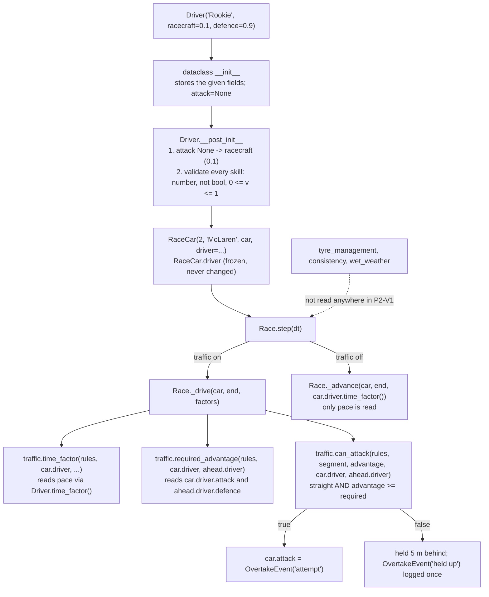

# P2-V1: Code flow

This document traces a configured driver from construction to its effect in a race:
1. how a `Driver` is created and validated;
2. how it is stored in a `RaceCar`;
3. where the race reads it, step by step;
4. a worked scenario with real numbers;
5. how to trace and debug it.

Line numbers are from the P2-V1 commit and may shift; symbol names are the stable reference. The race loop is unchanged since V5/V9 (see [V3 CODE_FLOW.md](../../versions/v3/CODE_FLOW.md) for the full traffic step).

## 1. Overview



## 2. Creating and validating a driver

Entry point: any code that builds a `Driver`. Here, the worked example in section 5 and `test_drivers.py`.

Call: `Driver("Rookie", racecraft=0.1, defence=0.9)`

1. **`dataclasses`' generated `__init__`** assigns the fields in declaration order (`drivers.py:11-18`):

   | Field | Value after `__init__` |
   |---|---|
   | `name` | `"Rookie"` (positional) |
   | `pace` | `1.0` (default) |
   | `racecraft` | `0.1` |
   | `attack` | `None` (default) |
   | `defence` | `0.9` |
   | `tyre_management`, `consistency`, `wet_weather` | `0.5` each (defaults) |

2. **`Driver.__post_init__`** (`drivers.py:20`) runs automatically after `__init__`:
   - **Loop 1** over `("attack", "defence")`:
     - `attack` is `None`, so it becomes `self.racecraft` = 0.1. The class is frozen, so a normal `self.attack = ...` would raise `FrozenInstanceError`. `object.__setattr__` bypasses that once, during construction.
     - `defence` is 0.9 and is kept.
   - **Loop 2** over `fields(self)[1:]` (every field after `name`, in order `pace, racecraft, attack, defence, tyre_management, consistency, wet_weather`). For each value the check is:
     ```python
     isinstance(value, bool) or not isinstance(value, (int, float)) or not 0 <= value <= 1
     ```
     - `True`/`False` are rejected first: in Python `bool` is a subclass of `int`, so without this check `True` would pass as 1.
     - `"0.5"`, `None`, `[0.5]` fail the type check.
     - `math.nan` fails `0 <= value <= 1` (NaN compares false to everything); `math.inf` and `-math.inf` are out of range.
     - The first failure raises `ValueError("<field> must be a number from 0 to 1, got <value>")`.
3. **Result:** `Driver(name='Rookie', pace=1.0, racecraft=0.1, attack=0.1, defence=0.9, tyre_management=0.5, consistency=0.5, wet_weather=0.5)`. It never changes after this point.

Because `None` is replaced before loop 2, `Driver(racecraft=2.0)` fails on `racecraft` (checked before `attack`), not on `attack`. `test_attack_and_defence_default_to_racecraft_unless_given` checks this.

## 3. Storing the driver in a race car

`RaceCar(2, "McLaren", CARS["McLaren"], driver=rookie)` (`race.py:34`: `driver: Driver = Driver()`).

- `RaceCar` is a normal (mutable) dataclass that holds the car's race state (`distance`, `laps`, `tyres`, ...). `driver` is one of its inputs, like `car` and `strategy`.
- `Race.__init__` resets the race-state fields of every car but never touches `driver`.
- The same `Driver` object can be shared by several cars or races; it is frozen, so nothing can leak between them.

## 4. Where the race reads the driver

`Race.step(dt)` (`race.py:234`) moves every running car `dt` seconds. Which branch runs depends on the race settings:

| Race settings | Branch in `Race.step` | Driver fields read |
|---|---|---|
| `traffic=None`, no race control | `self._advance(car, end, car.driver.time_factor())` | `pace` |
| `traffic=None`, race control | `race_control.pace_factor(car.driver.time_factor(), ...)` | `pace` |
| traffic on (the `Race` default) | `self._drive(car, end, factors)` | `pace`, `attack`, `defence` |

Inside **`Race._drive(car, end, factors)`** (`race.py:336`), in order:

1. `ahead = self.car_ahead(car)` and `interval = self.interval(car, ahead)`: the nearest car in front on track and the time gap to it (s).
2. `factor = time_factor(rules, car.driver, segment, interval, drs)` (`traffic.py`): starts from `car.driver.time_factor()` (pace), then applies dirty air in corners and DRS on long straights. Race control may scale it again. Stored in `factors[car.number]`.
3. `closing = ... self._free_distance(car, end, factor) > ahead.distance - rules.min_gap`: would this car end the step within 5 m of the car ahead?
4. If closing and overtaking is allowed:
   - `advantage = self._speed(car, car.distance, factor) - self._speed(ahead, car.distance, factors[ahead.number])`: both cars' speeds (m/s) at the follower's position.
   - `required = required_advantage(rules, car.driver, ahead.driver)` (`traffic.py:45`). **This is the P2-V1 change.** It reads `car.driver.attack` (the follower is the attacker) and `ahead.driver.defence` (the car ahead is the defender):
     ```python
     return rules.overtake_margin - rules.racecraft_effect * (attacker.attack - defender.defence)
     ```
   - `attempt = OvertakeEvent(end, car.laps + 1, car.number, ahead.number, "attempt", advantage, required, drs)` records the numbers.
   - `can_attack(rules, segment, advantage, car.driver, ahead.driver)` (`traffic.py:50`) is true only on a straight with `advantage >= required_advantage(...)`.
     - **True:** `car.attack = attempt`. The pass is in progress.
     - **False:** the car may move no further than `ahead.distance - min_gap` this step, and `OvertakeEvent(..., "held up")` is appended to `race.overtakes` if it was not already held by this car.
5. `self._advance(car, end, factor, limit)` moves the car.
6. Afterwards: `passed` if the car is now in front, `aborted` if it dropped back more than 5 m.

**State that changes:** `car.attack`, `car.held_by`, `car.distance` and `race.overtakes`. The `Driver` never changes.

**Not read anywhere:** `tyre_management`, `consistency`, `wet_weather`. You can check this with `grep -rn "tyre_management\|consistency\|wet_weather" --include=*.py .`. Only `drivers.py` and `test_drivers.py` match.

**The strategist** (`rl/env.py`) builds `RaceCar(...)` without a driver, so every car gets `Driver()`. That resolves to attack = defence = 0.5, giving `required_advantage` = 2.0 m/s as in V9. The strategist's observations, actions and rewards are unchanged.

## 5. Worked scenario: the Rookie defends

Same race as IMPLEMENTATION.md §10: `MonzaV0`, 6 laps, `dt` = 0.1 s, traffic on, no weather or race control.

```python
grid = [RaceCar(1, "Mercedes", CARS["Mercedes"], driver=Driver("Defender", racecraft=0.9)),
        RaceCar(2, "McLaren", CARS["McLaren"], driver=Driver("Rookie", racecraft=0.1, defence=0.9)),
        RaceCar(3, "McLaren", CARS["McLaren"], driver=Driver("Veteran", racecraft=0.9))]
race = Race(MonzaV0(), 6, grid)
race.run(0.1)
```

Resolved profiles (attack, defence): Defender (0.9, 0.9), Rookie (0.1, **0.9**), Veteran (0.9, 0.9).

| Race time | `_drive` for | Car ahead | `required_advantage` | Advantage | Outcome |
|---|---|---|---|---|---|
| 13.9 s, lap 1 | #3 Veteran | #2 Rookie | 2.0 − (0.9 − 0.9) = 2.0 | +0.00 | held up (identical cars, no advantage) |
| 192.3 s, lap 3 | #2 Rookie | #1 Defender | 2.0 − (0.1 − 0.9) = 2.8 | +6.56 (DRS) | attempt, then passed |
| 192.8 s, lap 3 | #3 Veteran | #1 Defender | 2.0 − (0.9 − 0.9) = 2.0 | +4.70 (DRS) | attempt, then passed |
| 393.0 s, lap 5 | #3 Veteran | #2 Rookie | 2.0 | +1.31 | held up |
| 487.4 s, lap 6 | #3 Veteran | #2 Rookie | 2.0 | +1.25 | held up |

Result: `#2 Rookie 567.518 s, #3 Veteran 568.149 s, #1 Defender 574.202 s`.

With the V3 profile (Rookie defence = racecraft = 0.1), the lap-5 row reads `required` = 2.0 − (0.9 − 0.1) = **1.2**. The Veteran's +1.31 m/s starts an attempt, and it passes on lap 6. The defence value is the only input that differs between the two races.

## 6. Tracing and debugging

- **See a resolved profile:** `print(Driver("X", racecraft=0.3, attack=0.8))` shows every skill after the `None` replacement.
- **See every pass decision with its numbers:** every `OvertakeEvent` in `race.overtakes` carries `advantage` and `required`:
  ```python
  for e in race.overtakes:
      print(e.lap, round(e.time, 1), e.attacker, e.defender, e.outcome, round(e.advantage, 2), round(e.required, 2))
  ```
  If `required` is not what you expect, check the attacker's `driver.attack` and the defender's `driver.defence`, not `racecraft`.
- **Check the formula alone:** `required_advantage(TrafficRules(), Driver(attack=1), Driver(defence=0))` gives 1.0.
- **Do not confuse two `attack`s:** `car.attack` is the pass in progress (`OvertakeEvent` or `None`); `car.driver.attack` is the skill (a float).
- **Why a fast car is `held up` with a big advantage:** `can_attack` also requires a straight. Corners never allow a pass, whatever the skills.
- **Run the checks:** `python3 test_drivers.py` (profile and attack/defence), `python3 test_traffic.py` (V3 overtaking and V3 result regression, unchanged).
