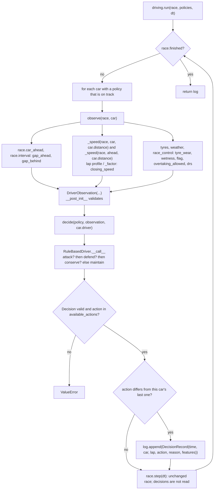

# P2-V2: Code flow

This document traces one concrete encounter: the Rookie (#2) closes on the Defender (#1) at Monza. It follows the observation being built, the policy choosing a response, the decision being checked and logged, and the race carrying on unaffected.

Line numbers are from the P2-V2 commit and may shift; symbol names are the stable reference. The race loop itself is unchanged (see [V3 CODE_FLOW.md](../../versions/v3/CODE_FLOW.md) and [P2-V1 CODE_FLOW.md](../p2-v1/CODE_FLOW.md)).

## 1. Overview



## 2. Where execution starts

The worked example (the README's P2-V2 example, and IMPLEMENTATION.md §11):

```python
grid = [RaceCar(1, "Mercedes", CARS["Mercedes"], driver=Driver("Defender", racecraft=0.9)),
        RaceCar(2, "McLaren", CARS["McLaren"], driver=Driver("Rookie", racecraft=0.1)),
        RaceCar(3, "McLaren", CARS["McLaren"], driver=Driver("Veteran", racecraft=0.9))]
log = run(Race(MonzaV0(), 6, grid), {1: CONSERVATIVE, 2: BALANCED, 3: AGGRESSIVE})
```

1. `Race(...)` sets up the race exactly as in P2-V1. Traffic is on (the default); there is no weather and no race control.
2. **`driving.run(race, policies, dt=0.1)`** (line 157) receives the race and a dict mapping car numbers to policies.
   - It first checks that every number in `policies` is in the race.
   - It sets up `log` (the list of records) and `last` (each car's last logged action).

## 3. One pass through the loop, at race time 12.6 s

At this point the Rookie is at 1,094.6 m, on the 1,210 m main straight (segment 0). The Defender is 14.1 m ahead at 1,108.7 m, and the Veteran is at 1,081.8 m.

### 3.1 `run` picks the car
`for car in race.cars:`. Car #2 has a policy (`BALANCED`), and `race._on_track(car)` is true (not finished, not retired, not in the pits), so `run` calls `observe(race, car)`.

### 3.2 `observe(race, car)` builds the observation (line 132)

| Step | Call | Result for #2 |
|---|---|---|
| car ahead | `race.car_ahead(car)` | #1 |
| car behind | first other on-track car whose `race.car_ahead(other)` is #2 | #3 |
| own speed | `_speed(race, car, car.distance)` = `race._profiles[2].speed_at(1094.6)` / `_factor(race, car)` = 97.90 / 1.0 | 97.90 m/s |
| own factor | `_factor`: no race control; traffic on, so `traffic.time_factor(rules, driver, segment, interval, drs)` = pace 1.0, no dirty air on a straight, no DRS on lap 1 | 1.0 |
| ahead's speed here | `_speed(race, ahead, car.distance)` = `race._profiles[1].speed_at(1094.6)` / 1.0 | 93.40 m/s |
| `laps_remaining` | `race.laps − car.laps − 1` = 6 − 0 − 1 | 5 |
| `on_straight` | `traffic.is_straight(race._segment(car))` | True |
| `gap_ahead` | `race.interval(car, ahead)` | 0.149 s |
| `closing_speed` | 97.90 − 93.40 | 4.508 m/s |
| `gap_behind` | `race.interval(behind, car)` | 0.131 s |
| `compound`, `tyre_wear` | `car.tyres.compound`, `car.tyres.wear(race.compounds)` | MEDIUM, 0.0 |
| `wetness` | no weather | 0.0 |
| `flag`, `overtaking_allowed` | no race control; `race._overtaking_allowed(car)` | GREEN, True |
| `drs` | `car.drs and race._drs_allowed()` | False |

`DriverObservation(...)` runs `__post_init__` (line 46). Every check passes: finite non-negative numbers, wear and wetness in 0–1, `closing_speed` given because `gap_ahead` is, correct types. The observation is frozen from here on.

### 3.3 `decide(BALANCED, observation, car.driver)` (line 101)
1. It calls `BALANCED(observation, driver)`, where `driver` is the Rookie's `Driver` (attack 0.1, defence 0.1, tyre_management 0.5).
2. **`RuleBasedDriver.__call__`** (line 195):
   - `available_actions(observation)` = all four actions: there is a car ahead and a car behind, and overtaking is allowed.
   - **Attack rule:** `ATTACK` is available and `gap_ahead` 0.149 ≤ `attack_gap` 1.0.
     - `needed = max(0.0, 1.0 − 1.0 × (0.1 − 0.5))` = 1.4 m/s.
     - `closing_speed` 4.508 > 1.4, so the rule returns `Decision(ATTACK, "close_and_faster", {"gap_ahead": 0.149, "closing_speed": 4.508, "needed": 1.4})`.
   - The defend and conserve rules are never reached.
3. Back in `decide`: the result is a `Decision`, its action is a `DriverAction`, and `ATTACK` is in the available set, so it is returned.

### 3.4 `run` logs the change
`last[2]` is `DEFEND` (logged at 2.0 s with the Veteran 0.137 s behind, inside the Rookie's 0.4 s window). `ATTACK` differs, so `run` appends:

```
DecisionRecord(time=12.6, car=2, lap=1, action=ATTACK, reason='close_and_faster',
               features={'gap_ahead': 0.149, 'closing_speed': 4.508, 'needed': 1.4})
```

and sets `last[2] = ATTACK`. `lap` is `car.laps + 1`, the lap being driven. Cars #1 and #3 go through the same steps; their actions did not change, so nothing is logged for them.

### 3.5 `race.step(0.1)` runs unchanged
`Race.step` → `Race._drive` for each car, in race order, exactly as in P2-V1. Nothing in `race.py` reads the decision.

The Defender moves first, about 9.3 m (93.4 m/s × 0.1 s). The Rookie's free move is about 9.8 m, which leaves it about 13.7 m behind: still outside `min_gap` (5 m). So no pass check happens, and `car.attack` stays `None`.

## 4. The next 1.1 s: the policy and the race disagree

| Time | Rookie speed | `closing_speed` | Policy (`BALANCED`) | Race |
|---|---|---|---|---|
| 13.4 s | 57.08 m/s (braking) | 1.914 | `ATTACK` (no new record) | |
| 13.5 s | 53.43 | 1.622 | `ATTACK` | |
| 13.6 s | 50.02 | 1.372 | 1.372 ≤ 1.4, so no attack; gap behind 0.131 ≤ window 0.4: **`DEFEND`**, logged | |
| 13.7 s | | | | `OvertakeEvent("held up")`: advantage 1.372, required **2.8** |

The race requires 2.0 − 1.0 × (0.1 − **0.9**) = 2.8 m/s, because the Defender's `defence` is 0.9. The policy cannot see that, so its own threshold (1.4 m/s) was lower. Choosing `ATTACK` did not and could not make the pass happen: in P2-V2 the race ignores the decision, and from P2-V3 on the race's rule will still decide whether an attack succeeds.

The race finishes with the same times as `race.run(0.1)`: `#3 567.052 s, #2 568.365 s, #1 574.202 s`.

## 5. Which state changes

| State | Changed by | When |
|---|---|---|
| `log` (list of `DecisionRecord`), `last` (dict) | `driving.run` | when a car's action changes |
| `car.distance`, `car.laps`, `car.attack`, `car.held_by`, `race.overtakes`, ... | `Race.step` | every step, exactly as without policies |
| `DriverObservation`, `Decision`, `Driver`, `RuleBasedDriver` | nobody | never: all are immutable |

No rewards are computed: there is no driver training until P2-V4.

## 6. Tracing and debugging

- **Inspect one car at one moment:**
  ```python
  race = Race(MonzaV0(), 6, grid)
  while race.time < 12.55:
      race.step(0.1)
  obs = observe(race, grid[1])
  print(obs)
  print(BALANCED(obs, grid[1].driver))
  ```
- **Read the log of one car:**
  ```python
  for r in log:
      if r.car == 2:
          print(round(r.time, 1), r.lap, r.action.name, r.reason, r.features)
  ```
  `features` holds the skill-adjusted threshold (`needed`, `window` or `conserve_from`), so you can see why a rule fired.
- **"Why didn't it attack?"** Check, in order:
  - `overtaking_allowed` and `gap_ahead is not None` (availability);
  - `gap_ahead ≤ attack_gap`;
  - `closing_speed > needed`.

  A `closing_speed` of exactly 0.0 between identical cars never attacks.
- **"Why did it attack but nothing happened?"** In P2-V2 actions have no effect. Compare with the race's `OvertakeEvent.required`, which includes the defender's defence.
- **Compare `closing_speed` with the race:** just before a step where the race logs an `OvertakeEvent` for car X, `observe(race, X).closing_speed` matched that event's `advantage` to 3 decimals in every check made for these docs. Both use the same factors at the follower's position. They could differ slightly if the car ahead crosses the 1 s dirty-air threshold during the step, because the race moves cars in order.
- **Policy errors:** `decide` raises `ValueError` naming the unavailable action and the policy's reason, e.g. `ATTACK is not available now (reason given: 'always')`.
- **Run the checks:** `python3 test_driving.py`.
