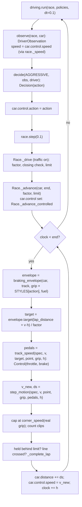

# P2-V3: Code flow

This document traces a controlled car approaching a corner. It follows the observation, the policy's decision, the controller's pedals, the physics integration, and the updated speed and distance. All numbers come from a real run of the README example (aggressive policy).

Line numbers are from the P2-V3 commit and may shift; symbol names are the stable reference.

## 1. Overview



## 2. Where execution starts

The README's P2-V3 example, with the aggressive policy:

```python
grid = [RaceCar(1, "Ferrari", CARS["Ferrari"], driver=Driver("Leader")),
        RaceCar(2, "McLaren", CARS["McLaren"], driver=Driver("Chaser"), control=CarControl())]
race = Race(MonzaV0(), 4, grid)
log = run(race, {2: AGGRESSIVE})
```

1. `CarControl()` (`control.py:53`) creates the McLaren's control state: `action=MAINTAIN_PACE`, `speed=0.0`, `clipped=0`.
2. `Race.__init__`:
   - checks `control_step` (default `CONTROL_STEP` = 0.02 s, must be in (0, 0.05]);
   - places both cars on the grid;
   - sets `car.control.speed` to the McLaren's profile speed at its grid slot (a flying start, like the Ferrari).
3. `driving.run(race, {2: AGGRESSIVE}, dt=0.1)` loops until the race is finished. Each pass:
   - builds the McLaren's observation;
   - asks the policy for a decision;
   - **copies the decision into `car.control.action`** (new in P2-V3);
   - logs it if the action changed;
   - calls `race.step(0.1)`.

   The Ferrari has no policy and no `CarControl`, so it moves by its profile as in every earlier version.

## 3. The scene

> **Correction (P2-V4):** since P2-V4's driving-dependent wear, the McLaren reaches this point with less worn tyres (grip 1.7973 instead of 1.79676), and the traced step ends at 93.994 m/s instead of 93.970. The steps below are the P2-V3 values.

Lap 2, race time 107.9 s. The first corner of `MonzaV0` (segment 1, radius 14 m) starts 1,210 m into the lap, at the end of the main straight. The McLaren is 1,089.9 m into the lap at 97.886 m/s, about 17 m behind the Ferrari. Its tyres are mediums with 3 % wear (grip 1.79676), and it carries 5.7 kg of fuel (mass 805.7 kg).

## 4. One race step, from observation to new position

### 4.1 Observation and decision (`driving.run`, before the step)
`observe(race, car)` → `DriverObservation(laps_remaining=2, speed=97.886, on_straight=True, gap_ahead=0.0805, closing_speed=−0.185, gap_behind=None, ...)`.
- `speed` is `car.control.speed`, because `driving._speed` now calls `race._speed`, which returns a controlled car's actual speed.
- `closing_speed` is negative: the Ferrari is slightly faster at this point.

`decide(AGGRESSIVE, obs, driver)`: `ATTACK` is available (a car ahead, overtaking allowed) and the gap 0.0805 s ≤ 1.5 s. But `closing_speed` −0.185 ≤ `needed` 0.3 m/s, so there is no attack. There is no car behind and the policy never saves tyres, so the result is `Decision(MAINTAIN_PACE, "no_trigger", {})`. `car.control.action = MAINTAIN_PACE`, which means a grip share of 0.97.

### 4.2 `race.step(0.1)` to `Race._advance_controlled`
`Race.step` → `Race._drive(car, end=108.0, factors)`:
- computes this step's `factor` for the McLaren: pace 1.0, no dirty air on a straight, no DRS on lap 2, green flag, so **1.0**;
- checks whether the McLaren would close to within 5 m of the Ferrari. `_free_distance` uses the McLaren's actual speed: 1,089.9 + 97.9 × 0.1 ≈ 1,099.7 m, still more than 5 m behind the Ferrari. So there is no pass check and no `limit`.

Then `Race._advance(car, 108.0, 1.0, None)` sees `car.control` and calls `_advance_controlled(car, 108.0, 1.0, None)` (`race.py:426`).

### 4.3 Sub-steps inside `_advance_controlled`
Every sub-step (h = min(0.02, time left)):
1. `line` = 2 × 5,793 m (end of lap 2), and `lap_distance` = `car.distance` − 5,793.
2. `spec` = McLaren spec with mass 800 + 5.7 kg.
3. `grip = car.tyres.grip(compounds, wetness)` = 1.79676.
4. `envelope = braking_envelope(car.car, track, 1.79676 × 0.97, 5.7)`. This is cached after the first call.
5. `point = envelope.point(lap_distance)`: a straight point (radius ∞, gradient 0).
6. `target = envelope.target(lap_distance + v × h) / 1.0`.
7. `pedals = track_speed(spec, v, target, point, grip, h)`.
8. `v_new, ds = step_motion(spec, v, point, grip, pedals, h)`.
9. Cap at `corner_speed` of the point reached (∞ on a straight: no cap), then move the car.

The six sub-steps of the 107.9 s step, as recorded:

| # | v (m/s) | target (m/s) | Pedals | a (m/s²) | v_new (m/s) | ds (m) |
|---|---|---|---|---|---|---|
| 1 | 97.886 | 100.071 | throttle 1.0 | +0.351 | 97.893 | 1.9578 |
| 2 | 97.893 | 98.522 | throttle 1.0 | +0.349 | 97.900 | 1.9579 |
| 3 | 97.900 | 96.987 | **brake 0.533** | −45.619 | 96.987 | 1.9489 |
| 4 | 96.987 | 95.465 | brake 0.993 | −76.097 | 95.465 | 1.9245 |
| 5 | 95.465 | 93.956 | brake 1.0 (saturated) | −74.766 | 93.970 | 1.8944 |
| 6 | 93.970 | 93.956 | brake 1.0 | −72.99 | 93.970 | 0.0 (h ≈ 10⁻¹⁷ s) |

- **Sub-steps 1–2: full throttle.** The target is above the car's speed. The McLaren is power-limited at 98 m/s (drive 7,559 N against drag 7,279 N), so it gains only 0.35 m/s².
- **Sub-step 3: braking starts**, 116 m before the corner. The envelope one sub-step ahead (at 1,095.8 m) is 96.987 m/s, below the car's 97.900. In `track_speed`:
  - needed = (96.987 − 97.900) / 0.02 = −45.65 m/s²;
  - coasting gives a(COAST) = −7,279 N / 805.7 kg = −9.035 m/s² (drag only);
  - full brake gives a(FULL_BRAKE) = −(55,338 N grip + 7,279 N drag) / 805.7 kg = −77.718 m/s²;
  - so brake = (−9.035 + 45.65) / (−9.035 + 77.718) = 0.533.

  `step_motion` then gives v_new = 97.900 − 45.65 × 0.02 = 96.987 m/s, which hits the target exactly, and ds = (97.900 + 96.987) / 2 × 0.02 = 1.949 m.
- **Sub-steps 4–5: harder braking.** The envelope falls faster than the brakes can follow, so the brake saturates at 1.0. The car is then slightly above the envelope (93.970 > 93.956). It is still within what the corner allows, because the envelope plans at 97 % grip and the real brakes use 100 %.
- **Sub-step 6:** five steps of 0.02 s do not sum to exactly 0.1 s in floating point. The loop takes one more sub-step of about 10⁻¹⁷ s, which moves the car 0 m. This is harmless.

**After the step:** `car.distance` is 1,099.578 m into the lap and `car.control.speed` = 93.970 m/s. No state other than `distance` and `control.speed` changed: no line was crossed, nothing clipped, no car ahead was reached.

### 4.4 The next step: the policy changes the motion
At 108.0 s the McLaren is faster than the Ferrari at this point: `closing_speed` = +1.691 m/s > `needed` 0.3 m/s, with a gap of 0.077 s. `AGGRESSIVE` returns **`ATTACK`**, and `car.control.action = ATTACK` (grip share 1.0).

In sub-step 1 of this step, the envelope now comes from `braking_envelope(..., 1.79676 × 1.0, ...)`. Its target 1.88 m ahead is **94.934 m/s**, against 92.46 m/s from the 0.97 envelope. The car is at 93.970, below the new target, so `track_speed` returns **throttle 1.0** (a = +1.45 m/s²), where the old style would have kept braking. From sub-step 2 on the car brakes again along the higher envelope (brake 0.343, then 1.0, 1.0, 0.648). It brakes later and harder, which is what attacking means in a longitudinal model. After the step it is at 1,108.811 m and 89.581 m/s.

At the end of the first corner (1,255 m) the McLaren is at 15.878 m/s. That is below the corner's real limit of 16.33 m/s at full grip, and the clip count is still 0.

## 5. State that changes

| State | Changed by | When |
|---|---|---|
| `car.control.action` | `driving.run` | before each race step, from the policy's decision |
| `car.control.speed`, `car.distance` | `Race._advance_controlled` | every sub-step |
| `car.control.clipped` | `Race._advance_controlled` | when a sub-step would exceed a corner's real grip limit by more than 1e-6 m/s |
| `car.laps`, `car.fuel`, `car.tyres`, `car.pit_exit`, `race.pit_events`, `car.finish_time` | `Race._complete_lap` (unchanged) | when the interpolated crossing reaches the line |
| `race.overtakes`, `car.attack`, `car.held_by` | `Race._drive` (unchanged), using the controlled car's actual speed | when the car closes on the car ahead |

There are still no rewards: driver training is P2-V4.

## 6. Tracing and debugging

- **Reproduce one sub-step:** with `race`, `car`, `h` and the scene's values:
  ```python
  envelope = braking_envelope(car.car, race.track, grip * STYLES[car.control.action], car.fuel)
  target = envelope.target(lap_distance + car.control.speed * h) / factor
  pedals = track_speed(spec, car.control.speed, target, envelope.point(lap_distance), grip, h)
  ```
  `CarControl` does not store pedals, so this is the way to see them. Recording `race.track_speed` / `race.step_motion` calls with a small wrapper (as done for the table above) also works.
- **Where does the car brake?** `[(x, envelope.target(x)) for x in range(1050, 1211, 20)]` shows the planned speed falling to the corner limit. For `MAINTAIN_PACE` at this grip it falls from 135 m/s at 1,050 m to 16.06 m/s at the corner (the limit at 97 % grip).
- **`clipped` > 0?** The car went faster than a corner allows. Check:
  - whether the sub-step is large (0.05 s);
  - whether the circuit has a steep downhill corner (Interlagos, Istanbul);
  - whether wetness just jumped;
  - whether `STYLES` was changed above 1.0.
- **A controlled car "won't attack"** when it is alone in front: `ATTACK` needs a car ahead (P2-V2 `available_actions`). Set `car.control.action` directly to test motion without a policy.
- **Compare with the profile:** `simulate_lap(car, track)[0]` is the ideal lap. An `ATTACK` controlled lap should be within about 0.3 % of it at the default sub-step.
- **Run the checks:** `python3 test_control.py`.
