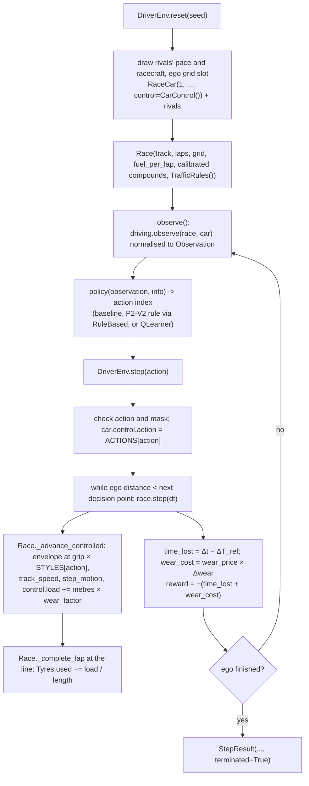

# P2-V4: Code flow

This document traces one complete episode of the driving environment: reset, observation, the driver's action, physics, reward and termination. It then shows how training and evaluation call the same loop. All numbers come from a real run.

Line numbers are from the P2-V4 commit and may shift; symbol names are the stable reference.

## 1. Overview



## 2. The episode

A short, fully traced episode: `DriverEnv(laps=1, opponents=1)`, `reset(seed=0)`, driven by the `push` baseline. Training and evaluation episodes work the same way, only longer (5 laps, 3 rivals).

### 2.1 `DriverEnv.__init__` (`rl/driver_env.py:64`)
1. Validates the settings (`test_environment_settings_are_validated`).
2. Builds `CIRCUITS["Monza"]()`, the V9 layout, 5,793 m. One instance per environment keeps the lap-profile and braking-envelope caches warm.
3. `load_config("calibrated")`: tyre grip 2.4811, so every compound's grip is scaled by 2.4811 / 1.8, as in `StrategyEnv`.
4. `fuel_per_lap` = 0.32 kg/km × 5.793 km = 1.854 kg.
5. `self.reference = LapProfile(CARS["McLaren"], track, 2.4811, 1.854)`: the ideal lap on new mediums with the start fuel, **78.817 s**.

### 2.2 `reset(seed=0)` (line 105)
1. `self._rng = random.Random(0)`.
2. Rivals: with one opponent that is the Red Bull, with driver `Driver("Rival 1", pace=0.84, racecraft=0.76)` (from `rng.uniform`).
3. Ego: `RaceCar(1, "McLaren", ..., Strategy(MEDIUM, 1.854 kg), Driver("Agent"), control=CarControl())`.
4. Grid slot: `rng.randrange(2)` = 1, so the grid is `[2, 1]` and the ego car starts second, 8 m behind the line (distance −8.0).
5. `Race(...)` places the cars and gives the ego car its flying-start speed from its profile (`CarControl.speed`), with `clipped = load = 0`.
6. `self._next = −8.0 + 250 = 242.0` m, the first decision point.
7. `_observe()` (line 169) calls `driving.observe(race, car)` (P2-V2) and scales it:

   ```
   DriverObservation(speed=94.88, gap_ahead=0.0843, closing_speed=−0.511, gap_behind=None, tyre_wear=0.0, ...)
   Observation(progress=0.0, speed=0.949, on_straight=1.0, gap_ahead=0.0281, closing=−0.051,
               gap_behind=1.0, held_up=0.0, drs=0.0, tyre_wear=0.0, position=1.0)
   ```

   `progress` is clamped at 0 on the grid. `position` = (2 − 1) / (2 − 1) = 1.0, last of two.
8. `info["action_mask"]` = `(True, True, False, True)`: ATTACK is allowed (a car ahead), DEFEND is not (nobody behind).

### 2.3 Step 0: one decision, start to finish
1. **Policy.** `push(observation, info)` returns 1 (ATTACK), because it is allowed.
2. **`step(1)`** (line 128):
   - checks that 1 is an int in 0–3 and allowed by the mask;
   - sets `car.control.action = ATTACK` (grip share 1.0);
   - records t₀ = 0.0 s, d₀ = −8.0 m, wear₀ = 0.0.
3. **Race loop:** `while car.finish_time is None and car.distance < 242.0: race.step(0.25)` runs **11 race steps**. In each one, `Race._drive` → `_advance` → `_advance_controlled` (P2-V3), and in each 0.02 s sub-step:
   - the target comes from `braking_envelope(..., grip × 1.0, fuel)`, the pedals from `track_speed`, and the motion from `step_motion`;
   - **new in P2-V4:** `car.control.load += metres moved × wear_factor(1.0, 0.5)` = metres × 1.0;
   - at the start line (0 m), `load` is reset to 0, because wear counts from the line.
4. **After the loop:** t₁ = 2.75 s, d₁ = 256.49 m, ego speed 97.18 m/s, `load` = 256.49 m.
5. **Reward parts:**
   - `time_lost` = (2.75 − 0.0) − (T_ref(256.49) − T_ref(−8.0)) = 2.75 − (2.6658 − (−0.0843)) = **−0.0000 s**. The car drove exactly at its ideal pace.
   - `tyre_wear()` (line 161) = (laps 0 + load 256.49 / 5793) × 0.03 = 0.001328.
   - `wear_cost` = 130 × 0.001328 = **0.1727 s**.
   - `reward` = −(−0.0000 + 0.1727) = **−0.1726**.
6. `self._next` = 492.0 m. The ego car has not finished and `max_steps` is `None`, so the step returns `StepResult(observation, −0.1726, False, False, info)`.

### 2.4 The rest of the lap

| Step | Action | Race time (s) | Distance (m) | time_lost (s) | wear_cost (s) | Reward | Position | What happens |
|---|---|---|---|---|---|---|---|---|
| 0 | ATTACK | 0 → 2.75 | −8 → 256 | −0.000 | 0.173 | −0.173 | 2 | flying start, behind the Red Bull |
| 2 | ATTACK | 5.25 → 9.00 | 501 → 747 | **0.090** | 0.166 | −0.256 | 2 | at 7.25 s the race logs `held up`: advantage 1.88 m/s, but 2.0 − (0.5 − 0.76) = 2.26 m/s is needed |
| 5 | ATTACK | 17.00 → 19.75 | 1251 → 1504 | 0.001 | 0.171 | −0.171 | 2 | ends 0.015 s behind, 1.3 m/s faster |
| 6 | ATTACK | 19.75 → 22.25 | 1504 → 1744 | 0.000 | 0.161 | −0.162 | **1** | at 21.5 s the ego car **passes**: advantage 3.04 m/s ≥ 2.26 |
| 7–22 | DEFEND | 22.25 → 78.75 | 1744 → 5762 | ≈ 0–0.008 each | ≈ 0.16–0.18 each | | 1 | nobody ahead, so ATTACK is masked; `push` picks DEFEND (the Red Bull is behind), still grip share 1.0 |
| 23 | DEFEND | 78.75 → **79.082** | 5762 → **5793** | −0.000 | 0.021 | −0.021 | 1 | crosses the line: finish |

### 2.5 Termination (step 23)
1. In the last sub-step, `_advance_controlled` interpolates the line crossing, adds the last metres to `load`, and calls `Race._complete_lap`.
2. **New in P2-V4:** because the car has `control`, `used = 0 + 5793 / 5793 = 1.0`, then `load = 0`. `car.laps = 1 = race.laps`, so `finish_time` = 79.082 s.
3. The `while` loop ends because `car.finish_time` is set. t₁ = `finish_time` (not `race.time`), and d₁ = 5,793 m.
4. `tyre_wear()` = (1.0 + 0) × 0.03 = 0.030. `wear_cost` = 130 × (0.030 − 0.02984) = 0.021 s.
5. `terminated = True`. `_observe()` returns the finished observation (progress 1, no cars ahead or behind), and the mask allows only MAINTAIN_PACE. `info["driver_observation"]` is `None`.
6. Another `step()` raises `RuntimeError` until `reset()`.

**Episode total.** The rewards sum to **−4.081**:
- time lost: 79.082 − (T_ref(5793) − T_ref(−8)) = 79.082 − 78.901 = 0.181 s;
- wear cost: 130 × 0.030 = 3.900 s.

`test_episode_ends_at_the_finish_and_rewards_add_up` checks this identity. One pass made, `clipped` = 0.

## 3. The same episode under another action
`CONSERVE_TYRES` from the start (alone on the grid, 1 lap, seed 0) gives grip share 0.90:
- the braking envelope is lower, so the car is slower everywhere (`time_lost` rises, `test_actions_change_the_motion_time_and_wear`);
- `wear_factor(0.90, 0.5)` = 0.43, so `load`, then `used`, then wear all fall to 43 % of the pushing value.

The reward compares the two in seconds through `wear_price`. `test_wear_price_trades_time_against_tyres` checks that the cheaper style flips as the price moves from 0 to 400.

## 4. Training: the same loop, plus an update (`rl/driver_learning.py`)
`train(env_kwargs, wear_price, run, settings)` (line 124), for each of 300 episodes:
1. ε = 0.3 + (0.02 − 0.3) × i / 299.
2. `observation, info = env.reset(seed=1000·run + i)`.
3. Until the episode ends:
   - `action = learner.act(observation, mask, ε)`: with probability ε a random allowed action; otherwise the allowed action with the highest `Q(state(observation), a)`, ties going to the lowest index;
   - `result = env.step(action)`;
   - `learner.update(observation, action, reward, next observation, next mask, terminated)`: one Q-learning update on the row for `state(observation)`, bootstrapping on the best *allowed* action in the next state (none at termination).

   **Example** (`test_q_learning_updates_and_plays_greedily`). With α = 0.5, γ = 0.9, Q = −0.5 and reward −1.0, a non-terminal update gives Q ← −0.5 + 0.5 × (−1.0 + 0.9 × max(−0.5, −1.0) − (−0.5)) = −0.975. The max is taken over allowed actions only (MAINTAIN −1.0, CONSERVE −0.5).
4. The episode's return is appended to the training history.

## 5. Evaluation and the stored experiment
`experiment(settings)` (line 183), for each wear price:
1. `_map` runs the 3 `train` jobs in parallel (forked processes; each is fully seeded).
2. The policies are the 6 baselines plus the 3 learners, which act greedily (`QLearner.__call__`).
3. `_map` runs `run_episode(env, policy, seed)` (line 148) for every policy on held-out seeds 10000–10029, split across 7 processes. The results are re-sorted by seed, so they do not depend on the number of processes.
4. `summarise` (line 206):
   - the mean cost and its parts for each policy;
   - the best baseline (highest mean return);
   - for each policy, the per-seed cost minus the best baseline's, with `research.stats.paired`'s bootstrap interval.
5. `main()` writes:
   - `rl/reports/driver_experiment.json`: settings, git revision, every training return, every learned table, every evaluation episode;
   - `rl/reports/driver_experiment.md`: `report(record)`.

## 6. Tracing and debugging
- **One episode by hand:**
  ```python
  env = DriverEnv(laps=1, opponents=1)
  observation, info = env.reset(seed=0)
  result = env.step(1)  # ATTACK
  print(result.info["time_lost"], result.info["wear_cost"], env._car.control.load)
  ```
- **Why is an action rejected?** Print `info["action_mask"]`. ATTACK needs a car ahead and DEFEND a car behind.
- **Reward looks wrong?** `-(info["time_lost"] + info["wear_cost"])` must equal the reward. `env.reference.time_at(d)` gives the ideal time to any distance.
- **Wear looks wrong?**
  - `env._car.control.load` is this lap's weighted metres;
  - `env._car.tyres.used` holds the completed laps' worth of wear;
  - `control.wear_factor(STYLES[action], driver.tyre_management)` is the rate.
- **What did a learner learn?** `learner.table()`, or the `"policy"` entries in `driver_experiment.json`, list the greedy action, the Q values and the visit counts for every visited state. State tuples are `(ahead, faster, held_up, behind_close, on_straight, drs)`.
- **Run the checks:**
  - `python3 test_driver_env.py`;
  - `python3 -m rl.driver_learning --smoke` (about 10 s, not a result).
