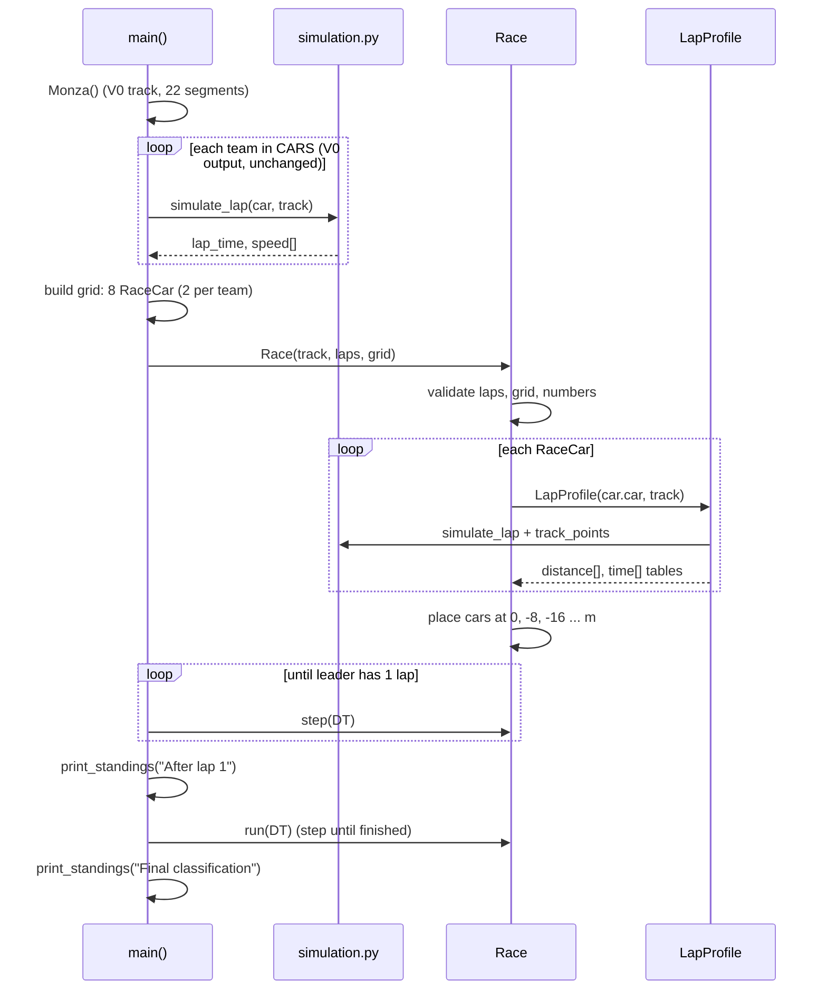
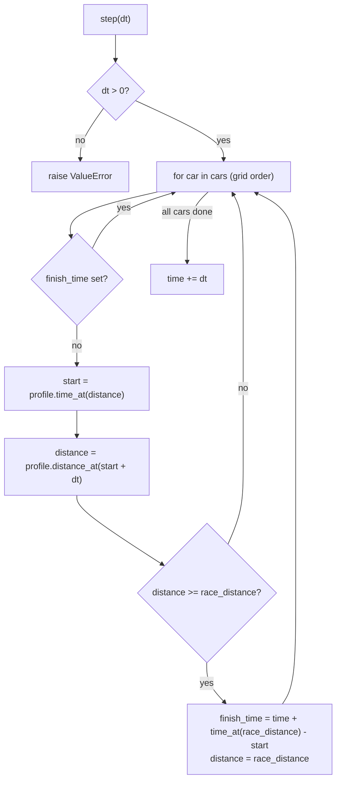

# V1: Code flow

This document follows the program from `python3 main.py` to the final classification. It shows what is called, in what order, and how data moves. See IMPLEMENTATION.md for the reasons behind each choice.

## 1. Entry point to finish, at a glance



## 2. Step by step

### 2.1 `main()` in `main.py`

1. `Monza()` runs V0's `Track.__init__`. That calls `Monza.build_track`, which fills `track.segments` with 22 `Straight`/`Corner` objects. `track.length` = 5 900 m.
2. **V0 block (unchanged).** For each team in `CARS`, `simulate_lap(car, track)` returns `(lap_time, speed)`, and the program prints lap time, top speed and slowest speed.
3. `laps` comes from the first command-line argument if present (`python3 main.py 5`), otherwise `RACE_LAPS = 53`. `int()` raises `ValueError` for non-integers.
4. Build the grid:
   ```python
   entries = [(team, car) for team, car in CARS.items() for _ in range(CARS_PER_TEAM)]
   grid = [RaceCar(number, team, car) for number, (team, car) in enumerate(entries, start=1)]
   ```
   `entries` lists each `(team, Car)` pair twice. The two `RaceCar`s of a team receive **the same `Car` object** but are separate `RaceCar` objects. Data created: 8 `RaceCar(number, team, car, distance=0.0, finish_time=None)`.
5. `race = Race(track, laps, grid)`. See 2.2.
6. Step until the leader has completed one lap, then print the standings.
7. `race.run(DT)` steps until every car has finished. Then print the final classification.

### 2.2 `Race.__init__` in `race.py`

| Order | Action | Data / state change |
|---|---|---|
| 1 | Reject `laps` that is not an int or is `< 1` | raises `ValueError` |
| 2 | Reject an empty grid | raises `ValueError` |
| 3 | Reject duplicate car numbers | raises `ValueError` |
| 4 | Store `track`, `laps`, `cars = grid`, `time = 0.0` | new race state |
| 5 | `race_distance = laps * track.length` | e.g. 53 × 5 900 = 312 700 m |
| 6 | `_profiles[number] = LapProfile(car.car, track)` for each car | one distance/time table per car |
| 7 | `car.distance = -slot * GRID_SPACING`, `car.finish_time = None` | cars placed on the grid |

### 2.3 `LapProfile.__init__`

1. `simulate_lap(car, track)` runs the V0 forward/backward passes and returns `speed`, a list of 5 900 values in m/s for Monza.
2. `track_points(track)` returns 5 900 tuples `(ds, radius, gradient)`.
3. Start both tables at `[0.0]`. For each point `i`, append:
   - `distance[-1] + ds`
   - `time[-1] + 2·ds / (speed[i] + speed[(i+1) % n])`
4. Result: two lists of 5 901 entries. `distance[-1]` = 5 900 m and `time[-1]` = the V0 lap time.

Team-mates get two identical tables. Each is built separately, which costs about 30 ms per car on Monza. Simplicity beats caching here.

### 2.4 `Race.step(dt)`: one simulation step



Important points:

- The race clock `self.time` advances **after** all cars have moved. So inside the loop, `self.time` is the time at the start of the step, which the finish-time formula needs.
- Finished cars are skipped. Their `distance` and `finish_time` never change again.
- Cars are processed in grid order, but the order does not matter: in V1 no car reads another car's state.

### 2.5 `time_at` and `distance_at`

```
time_at(D):     laps, rest = divmod(D, distance[-1])
                return laps * time[-1] + _interpolate(rest, distance, time)

distance_at(τ): laps, rest = divmod(τ, time[-1])
                return laps * distance[-1] + _interpolate(rest, time, distance)
```

`_interpolate(x, xs, ys)`:

1. `i = bisect_right(xs, x)` finds the first table entry greater than `x`. `i` is capped at `len(xs) − 1` for the rare case where floating-point `divmod` returns a remainder exactly equal to the lap.
2. It returns the point on the straight line from `(xs[i−1], ys[i−1])` to `(xs[i], ys[i])`.

### 2.6 `standings()`, `laps_completed()` and `finished`

- `standings()` returns a **new list**. Finished cars come first, sorted by `finish_time`. Running cars follow, sorted by `distance`, furthest first. It does not change any state.
- `laps_completed(car)` returns `race.laps` for a finished car, otherwise `max(0, int(distance // track.length))`.
- `finished` is `True` once every car has a `finish_time`.

### 2.7 `print_standings()` in `main.py`

For each car in `race.standings()`, it prints position, number, team, laps completed and a gap:

| Car state | Gap shown |
|---|---|
| Still running | `distance − leader.distance` in metres (≤ 0) |
| Finished leader | its total race time in seconds |
| Finished, not leader | `finish_time − leader.finish_time` in seconds |

## 3. Concrete example: one step for two cars

Race: Monza, 2 laps, grid `[#1 Red Bull, #2 McLaren]`, `dt = 0.5`. Here is the state just before the first `step(0.5)`:

```
race.time = 0.0
#1 RaceCar(distance=0.0,  finish_time=None)   profile lap 94.5546 s
#2 RaceCar(distance=-8.0, finish_time=None)   profile lap 93.9983 s
```

Inside `step(0.5)`:

1. `#1`: `time_at(0.0)` → `divmod(0, 5900) = (0, 0)` → `0.0 s`. `distance_at(0.5)` → `29.664 m`. 29.664 is less than 11 800, so the car has not finished.
2. `#2`: `time_at(−8.0)` → `divmod(−8, 5900) = (−1, 5892)` → `−93.9983 + 93.8611 = −0.1372 s`. `distance_at(0.3628)` → `21.950 m`. It has not finished.
3. `race.time = 0.5`.

State after the step:

```
race.time = 0.5
#1 distance 29.664 m   laps_completed 0
#2 distance 21.950 m   laps_completed 0
standings() -> [#1, #2]
```

A **finishing step** (#2 at race time 188.0 s, distance 11 792.19 m):

1. `start = time_at(11792.19) = 187.8628 s`.
2. `distance_at(188.3628) = 11 822.16 m`, which is at least 11 800, so the car has finished.
3. `finish_time = 188.0 + time_at(11800) − 187.8628 = 188.0 + 187.9967 − 187.8628 = 188.1339 s`.
4. `distance = 11 800` (clamped).

IMPLEMENTATION.md section 6 continues this example through the McLaren taking the lead and both finishes.

## 4. Debugging guide

| Question | How to check |
|---|---|
| Is the V0 profile still the same? | `python3 test_simulation.py`. `test_monza_lap_times_unchanged_from_v0` compares against values recorded at V0. |
| What table does a car use? | `p = race._profiles[number]`; look at `p.distance[:5]`, `p.time[:5]` and `p.time[-1]` (lap time). |
| Where should a car be at race time t? | `p.distance_at(p.time_at(start_distance) + t)`, where `start_distance = -slot * 8`. |
| Why is a car ahead? | Print `[(c.number, c.distance, c.finish_time) for c in race.standings()]` after each `step`. |
| Is a finish time wrong? | Check `finish_time ≈ laps * p.time[-1] − p.time_at(start_distance)`. |
| Quick end-to-end run | `python3 main.py 1` (a 1-lap race). |
| Step through one step | Put `breakpoint()` at the top of `Race.step` and inspect `car`, `start` and `car.distance` in the debugger. |

Common pitfalls:

- Reusing `RaceCar` objects in a second `Race` resets them. Build fresh ones.
- `race.standings()` returns a new list. Reordering it does not affect the race.
- Car numbers must be unique, because they key `_profiles`.
