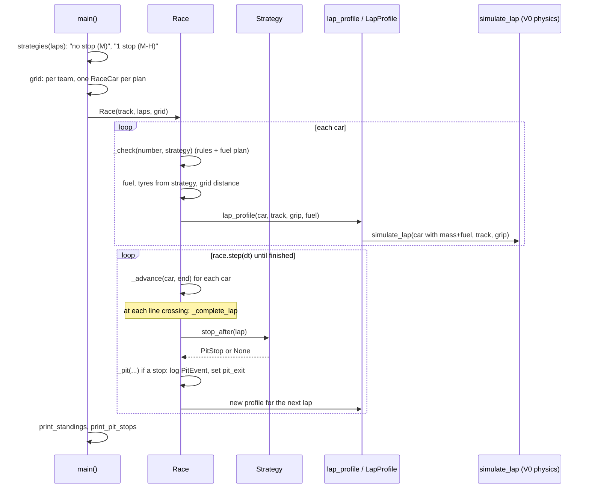
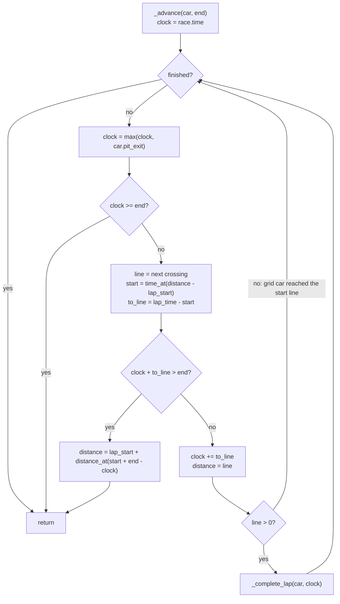

# V2: Code flow

This document follows `python3 main.py` from start to finish, with the focus on what V2 adds: fuel, tyre wear, the pit decision, the stop, and the car rejoining. V1's flow (grid, steps, standings) is in [../v1/CODE_FLOW.md](../v1/CODE_FLOW.md). Only what changed is repeated here.

## 1. Overview

## 2. Setup

### 2.1 `main()`

1. Prints the V0 flying-lap table. This part is unchanged.
2. `laps` comes from `argv[1]`, or `RACE_LAPS = 53`.
3. `strategies(laps)` returns two `Strategy` objects:
   - both start on mediums with `laps × FUEL_PER_LAP` kg;
   - the second has `PitStop(laps // 2, HARD)`.
4. `entries` holds one `(team, car, plan)` per team per plan, so each team has one car on each plan. The `RaceCar`s are numbered 1–8.
5. `Race(track, laps, grid)` with default settings: `pit_loss` 22 s, `fuel_per_lap` 1.9 kg, the `COMPOUNDS` table.

`main.py 1` fails on purpose: `PitStop(0, ...)` is not a valid stop.

### 2.2 `Race.__init__`

These are the V1 steps, plus the V2 additions:

| Order | Action | State change |
|---|---|---|
| 1–3 | V1 checks: `laps`, empty grid, unique numbers | — |
| 4 | Reject negative `pit_loss` or `fuel_per_lap` | — |
| 5 | Store settings; `pit_events = []` | race state |
| 6 | For each car: `strategy = car.strategy or Strategy(MEDIUM, laps × fuel_per_lap)` | `_strategies[number]` |
| 7 | `_check(number, strategy)`: compounds, stop laps, fuel plan (IMPLEMENTATION.md §5.3, §7.1) | raises `ValueError` if impossible |
| 8 | Grid distance, `finish_time = None`, `laps = 0`, `pit_exit = 0` | car state reset |
| 9 | `fuel = strategy.fuel`, `tyres = Tyres(strategy.compound)` | V2 car state |
| 10 | `_profiles[number] = _profile(car)` | first lap's profile |

`_profile(car)` calls `lap_profile(car.car, track, car.tyres.grip(compounds), car.fuel)`. That calls `LapProfile`, which calls `simulate_lap(Car(replace(spec, mass=spec.mass + fuel)), track, tyre_grip)`, unless an identical profile is already cached.

## 3. One step: `Race.step(dt)` → `_advance(car, end)`

`step` checks `dt > 0` and calls `_advance(car, self.time + dt)` for every car. It then sets `self.time += dt`.

### 3.1 `_complete_lap(car, clock)`

1. `car.laps += 1`
2. `car.fuel -= fuel_per_lap`
3. `car.tyres = replace(car.tyres, laps=car.tyres.laps + 1)`. This is a new frozen value.
4. If `car.laps == race.laps`, then `finish_time = clock` and the method returns. No strategy call and no new profile.
5. `stop = _strategies[number].stop_after(car.laps)`
6. If there is a stop, call `_pit(car, stop, clock)`.
7. `_profiles[number] = _profile(car)`, for the new fuel and tyres.

### 3.2 `_pit(car, stop, clock)`

1. `duration = pit_loss + stop.fuel / REFUEL_RATE`
2. `tyres = Tyres(stop.compound)` if a compound is given, else the current set.
3. Append `PitEvent(number, laps, clock, duration, car.tyres, tyres, stop.fuel)`.
4. `car.tyres = tyres`, `car.fuel += stop.fuel`, `car.pit_exit = clock + duration`.

Back in `_advance`, the next loop iteration sets `clock = max(clock, pit_exit)`. The car therefore cannot move until the stop is over, in this step or in later ones.

## 4. Traced example: fuel, wear, decision, stop, rejoin

This is the McLaren alone at Monza, on the plan `Strategy(MEDIUM, 100.7, (PitStop(26, HARD),), "1 stop (M-H)")`. Grid slot 0, `dt = 0.5 s`, default settings. Monza is 5 900 m, so the lap-k line is at k × 5 900 m.

### 4.1 Laps 24–26: fuel falls, wear rises

Each row is the state right after the line crossing that ends the lap.

| Lap done | Crossing step | Fuel (kg) | Tyres (laps, wear) | μ for next lap | Next lap's profile time (s) |
|---|---|---|---|---|---|
| 24 | 2313.0 → 2313.5 | 55.1 | medium 24, 0.72 | 1.7222 | 96.7122 |
| 25 | 2410.0 → 2410.5 | 53.2 | medium 25, 0.75 | 1.7190 | 96.7392 |

Every lap the same three things happen inside `_complete_lap`:

- fuel −1.9 kg;
- tyre laps +1, so wear +0.03 and μ −0.0032;
- a new profile is built.

Each new medium lap here is about 0.027 s slower than the previous one. Lost grip outweighs lost fuel.

### 4.2 Lap 26: the decision and the stop

Step `race.time` = 2506.5 → `end` = 2507.0. `_advance(car, 2507.0)`:

1. `clock = max(2506.5, pit_exit=0) = 2506.5`. The car is running.
2. `line = 26 × 5900 = 153 400 m` and `lap_start = 147 500 m`. The car is at 153 385.33 m, so it is 5 885.33 m into lap 26.
3. `start = time_at(5885.33)` on the lap-26 profile (96.7392 s lap), which gives `to_line = 0.2709 s`.
4. `2506.5 + 0.2709 = 2506.7709 ≤ 2507.0`, so the line is reached in this step. Then `clock = 2506.7709` and `distance = 153 400`.
5. `_complete_lap(car, 2506.7709)`:
   - laps 26, fuel 53.2 → **51.3 kg**, tyres → **medium, 26 laps (wear 0.78)**;
   - 26 ≠ 53, so not finished;
   - `stop_after(26)` returns `PitStop(lap=26, compound=HARD, fuel=0.0)`. **This is the pit decision.**
   - `_pit`:
     - duration = 22.0 + 0.0 / 10 = **22.0 s**;
     - log `PitEvent(1, 26, 2506.7709, 22.0, Tyres(MEDIUM, 26), Tyres(HARD, 0), 0.0)`;
     - tyres → **hard, 0 laps**;
     - `pit_exit = 2528.7709`.
   - The new profile is for μ = 1.775, fuel 51.3 kg, with a lap time of 95.5886 s.
6. Back in the loop: `clock = max(2506.7709, 2528.7709) = 2528.7709`, which is at least `end` (2507.0), so the method returns. The car stays at 153 400 m.

### 4.3 Stationary steps

For each step from 2507.0 to 2528.5 s, `_advance` sees `clock = pit_exit = 2528.7709 ≥ end` and returns at once. `distance` stays 153 400.0. Cars that are still running pass it in the standings.

### 4.4 Rejoin

Step 2528.5 → 2529.0:

1. `clock = max(2528.5, 2528.7709) = 2528.7709`, which is less than 2529.0.
2. `line = 27 × 5900 = 159 300` and `lap_start = 153 400`. Then `start = time_at(0) = 0` and `to_line = 95.5886`.
3. The line is not reached, so `distance = 153 400 + distance_at(0 + 2529.0 − 2528.7709) = 153 400 + 13.12 m`.

The car is racing again, on hards.

### 4.5 After the stop

| Lap done | Fuel (kg) | Tyres | μ for next lap | Next profile (s) |
|---|---|---|---|---|
| 27 | 49.4 | hard 1, wear 0.02 | 1.7729 | 95.5906 |
| 28 | 47.5 | hard 2, wear 0.04 | 1.7707 | 95.5926 |
| 53 (finish) | ≈ 0 (−9 × 10⁻¹⁴) | hard 27, wear 0.54 | — | — |

The finish time is 5110.338 s, and `race.pit_events` holds one event.

## 5. Debugging guide

| Question | How to check |
|---|---|
| Is V0 still intact? | `python3 test_simulation.py` |
| Is V1 still reproducible? | `python3 test_race.py`. `test_v1_monza_race_results_unchanged` runs V2 with fuel and wear off. |
| Why is a plan rejected? | The `ValueError` message names the car and the rule. The rules are in `Race._check`. |
| What does the car carry now? | `car.fuel`, `car.tyres`, `car.tyres.wear(race.compounds)`, `car.tyres.grip(race.compounds)` |
| What pace is it on this lap? | `race._profiles[number].time[-1]` is the current lap's flying-lap time. |
| When and what did it pit? | `for e in race.pit_events: print(e)` |
| Is a car in the pits right now? | `race.time < car.pit_exit` |
| How much does fuel or grip matter? | `LapProfile(car, track, tyre_grip=..., fuel=...).time[-1]` for two values |
| Watch a stop step by step | Put `breakpoint()` in `Race._pit`, or print `car.distance` and `car.pit_exit` after each `race.step`. |
| Things look stale after editing a car | `lap_profile` caches by object identity. Call `lap_profile.cache_clear()`. |

Common pitfalls:

- `PitStop(lap=k)` happens as lap k is **completed**, not at the start of lap k.
- `compound=None` keeps the worn set; it does not fit new tyres of the same compound. To fit fresh tyres of the same compound, pass that compound.
- Wear depends on the race's `compounds` table. Call `tyres.wear(race.compounds)`, not plain `tyres.wear()`, when the race uses a custom table.
