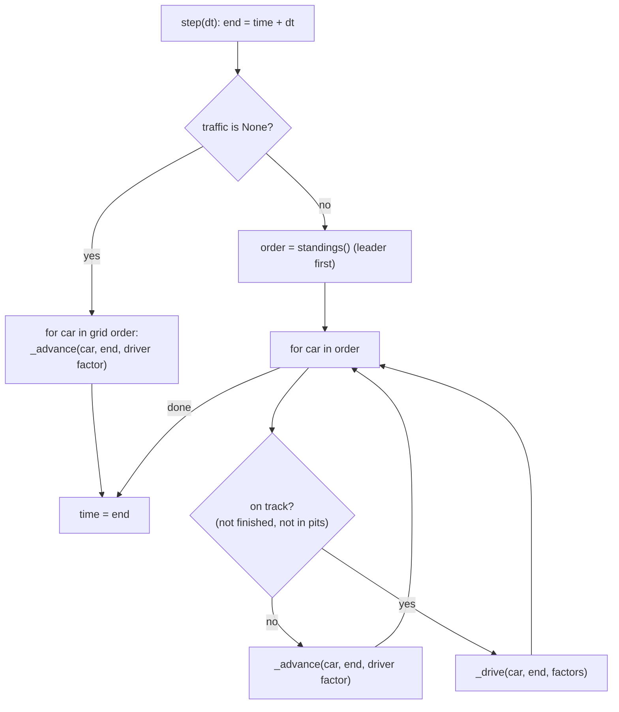
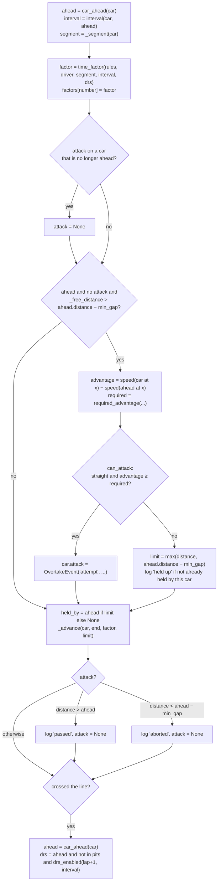

# V3: Code flow

This document traces one step of the V3 race loop and then follows two cars through an overtake. V1's grid and standings, and V2's fuel, tyres and stops, are covered in [../v1/CODE_FLOW.md](../v1/CODE_FLOW.md) and [../v2/CODE_FLOW.md](../v2/CODE_FLOW.md). They are unchanged inside `_advance`.

## 1. From `main()` to the race loop

1. `main()` prints the V0 table and builds the V2 grid: per team, one car on "no stop (M)" and one on "1 stop (M-H)". Each `RaceCar` gets the default `Driver()`.
2. `Race(track, laps, grid)` sets everything up as in V2, plus:
   - `traffic = TrafficRules()`;
   - `overtakes = []`;
   - `_segment_starts`;
   - each car's `drs`, `attack` and `held_by` reset.
3. The race steps with `DT = 0.1 s` until the leader has a lap, then prints the standings. `race.run(DT)` finishes the race. Then come the standings, the pit stops and `print_overtakes`.

## 2. One step



### 2.1 `_drive(car, end, factors)`



### 2.2 `_advance(car, end, factor, limit)`

This is V2's loop with two additions:

- **`factor`** multiplies the race time needed to reach a target. It divides the profile time available in the remaining part of the step.
- **`limit`.** The target becomes `min(next line, limit)`. If the car reaches the limit before `end`, it stops there for the rest of the step. If `limit ≤ distance`, it does not move at all.

Line crossings, fuel, tyres, the strategy and pit stops are processed exactly as in V2.

### 2.3 Data used by a decision

| Value | Source | Moment |
|---|---|---|
| The car ahead's position | `ahead.distance` | **after** the car ahead's move this step |
| The car's own position, segment, interval, factor | `car.distance`, `_segment`, `interval`, `time_factor` | **before** its own move |
| The car ahead's factor | `factors[ahead.number]` | decided during the car ahead's own `_drive` this step |
| Speeds | `LapProfile.speed_at(x)` with `x = car.distance`, for both cars | each car's current lap profile (V2 state) |

## 3. Helpers

| Function | Returns |
|---|---|
| `car_ahead(car)` | Nearest on-track car with a larger `distance`, or `None` |
| `interval(car, ahead)` | `T(ahead) − T(car)` on the follower's profile, in seconds |
| `_segment(car)` | `track.segments[bisect_right(_segment_starts, distance % L)]` |
| `_free_distance(car, end, f)` | `lap_start + distance_at(time_at(distance − lap_start) + (end − time) / f)` |
| `_speed(car, x, f)` | `profile.speed_at(x) / f` |
| `_next_line(car)` | `(laps + 1) × L`, or `0` while still behind the start line |

## 4. Traced example: approach, range, attempt, pass

The race:

```python
merc = RaceCar(1, "Mercedes", CARS["Mercedes"], Strategy(MEDIUM, 8 * 1.9))
mcl  = RaceCar(2, "McLaren",  CARS["McLaren"],  Strategy(MEDIUM, 8 * 1.9, (PitStop(1, SOFT),)))
race = Race(Monza(), 8, [merc, mcl], pit_loss=4.0)
race.step(0.1)   # repeatedly
```

Both cars have default drivers (racecraft 0.5), so `required` = 2.0 m/s.

### 4.1 Start: in range immediately, held up

- **Step 0.0 → 0.1.** #2 starts 8 m behind, 0.133 s. It is in dirty air, but in the Parabolica (a corner), so no attempt is possible there.
- **Step 1.8 → 1.9**, on the main straight:
  - #2's free move would end within 5 m of #1;
  - advantage = +1.489 m/s < 2.0, so refused;
  - `limit = 117.51 m` (#1 at 122.51 − 5);
  - `"held up"` is logged and `held_by = 1`.
- **Step 3.4 → 3.5.** #1 pulls away slightly, so #2's free move no longer reaches the 5 m line. `held_by` returns to `None`.

### 4.2 Pit, rejoin, approach

- **95.68 s.** #2 completes lap 1. V2's `_complete_lap` → `_pit` sets `pit_exit` = 99.68 s and fits softs.
- From then until 99.68 s, `_on_track(#2)` is `False`. #2 is moved by `_advance` only, waits in the pits, and is nobody's "car ahead".
- **99.8 s.** #2 is back on track, 3.97 s behind (`interval`).
- **193.5 s.** The interval is 2.097 s. #2 is gaining 1–2 s per lap: fresh softs, a faster car, and no dirty air yet.

### 4.3 Entering the interaction range

| Step | #1 distance | #2 distance | Interval at #2's step | Segment of #2 | #2 factor |
|---|---|---|---|---|---|
| 279.9 → 280.0 | 17 336.11 (after its move) | 17 271.88 → 17 277.75 | 1.094 s | Corner (r = 95 m, Parabolica) | 1.0000 (interval ≥ 1.0: clean air) |
| 280.9 → 281.0 | 17 389.24 (after its move) | 17 330.57 → … | just under 1.0 s | Corner (Parabolica) | 1.02 (**dirty air**, first step) |

The interval is measured inside `_drive`, after #1 has already moved in that step. It is therefore about 0.09 s larger than the same gap measured once both cars have moved. That is why the first dirty-air step comes slightly later than an end-of-step print would suggest.

### 4.4 DRS detection at the line

**Step 287.3 → 287.4.** #2 crosses the line, completing lap 3. Inside `_advance`, `_complete_lap` burns fuel and ages the softs. Then, back in `_drive`:

```
ahead = car_ahead(#2) = #1      interval = 0.432 s
drs = True   because   lap 4 ≥ drs_from_lap (3)   and   0.432 < drs_interval (1.0)   and   #2 is not in the pits
```

### 4.5 First attempt on the main straight: refused

**Step 297.8 → 297.9.** #1 has already moved, to 18 656.61 m. Then for #2:

| Quantity | Value |
|---|---|
| `car.distance` | 18 641.54 m (1 091.5 m into lap 4) |
| `interval` | 0.155 s |
| `segment` | Straight, 1 210 m, so it is a DRS zone |
| `factor` | driver 1.0 × DRS 0.965 = **0.965** (no dirty air on straights) |
| `_free_distance` | 18 651.62 > 18 656.61 − 5 = 18 651.61, so this is an **attempt** |
| `v_mcl(x)` | 100.78 m/s (profile speed ÷ 0.965) |
| `v_merc(x)` | 98.88 m/s |
| `advantage` | **+1.907 m/s** < required 2.0 |

- Result: **refused**, with `limit = 18 651.61`. `"held up"` is logged because `held_by` was `None`. `held_by` is now 1.
- `_advance(..., limit=18 651.61)`: #2 reaches 18 651.61 m before the end of the step and waits there. The gap after the step is exactly 5.00 m.

### 4.6 Second attempt: allowed

**Step 299.3 → 299.4.** #1 moves to 18 804.28 m. #2 is at 18 790.32 m (still held at 5.00 m).

| Quantity | Value |
|---|---|
| `segment` | Straight (1 210 m), about 1 090 m in |
| `factor` | 0.965 |
| `_free_distance` | 18 800.46 > 18 799.28, so this is an attempt |
| `v_mcl(x)` | 101.46 m/s |
| `v_merc(x)` | **95.99 m/s**. At this spot the Mercedes profile is already braking for Turn 1, because its lower downforce means an earlier braking point. |
| `advantage` | **+5.466 m/s** ≥ 2.0, so **attack allowed** |

- `car.attack = OvertakeEvent(299.4, lap 4, 2, 1, "attempt", 5.466, 2.0, drs=True)`.
- `limit = None`, so #2 moves freely to 18 800.46 m. The gap is now 3.82 m, inside `min_gap`, which is allowed during an attack.

### 4.7 Steps 299.4 → 299.8: the pass completes

| Step end | #1 | #2 | Gap #1 − #2 | `attack` |
|---|---|---|---|---|
| 299.4 | 18 804.28 | 18 800.46 | 3.82 | attempt |
| 299.5 | 18 812.67 | 18 810.11 | 2.56 | attempt |
| 299.8 | 18 834.90 | 18 834.99 | **−0.09** | resolved |

At 299.8, after `_advance`, #2's distance (18 834.99) is greater than #1's (18 834.90). The race logs `replace(attack, time=299.8, outcome="passed")` and sets `attack = None`.

### 4.8 Positions update

`standings()` sorts running cars by `-distance`, so it now returns `[#2, #1]`. Nothing else is stored, so the race position *is* the distance order.

In the very next step (299.8 → 299.9), #1 is the follower. Its free move would end within 5 m of #2, and its advantage is −6.67 m/s, so `"held up"` is logged for #1 behind #2.

## 5. Debugging guide

| Question | How to check |
|---|---|
| Who is near whom? | `[(c.number, race.car_ahead(c) and race.car_ahead(c).number) for c in race.cars]` |
| How close? | `race.interval(car, race.car_ahead(car))` |
| Why is a car slow here? | `time_factor(race.traffic, car.driver, race._segment(car), interval, car.drs)` |
| Does it have DRS this lap? | `car.drs`. Re-decided only at the line. |
| Why no pass? | Look at the `"held up"` events: `advantage` against `required`, and whether the segment was a straight (`race._segment(car)`). |
| Is a pass in progress? | `car.attack` (the deciding numbers) |
| Who is stuck behind whom? | `car.held_by` |
| Does it behave like V2 without traffic? | `Race(..., traffic=None)`. `test_v2_race_results_unchanged_without_traffic` checks this. |
| Result changes with `dt`? | Expected with traffic (IMPLEMENTATION.md §12). Compare the same `dt`. |
| Step through a decision | Put `breakpoint()` in `Race._drive` with `if car.number == N and race.time > T`. |
