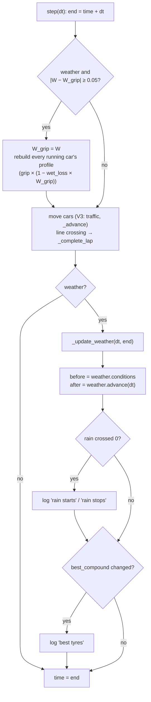

# V4: Code flow

This document traces the weather inside a race step: the timeline being read, wetness integrated, grip refreshed, a weather-aware pit decision, and the event log. Traffic (V3), fuel, tyres and pit stops (V2), and the grid and standings (V1) work as described in earlier CODE_FLOW files and are not repeated here.

## 1. Setting up a wet race

```python
timeline = [WeatherPoint(0, 24.0), WeatherPoint(500, 24.0), WeatherPoint(560, 21.0, 6.0),
            WeatherPoint(1100, 19.0, 6.0), WeatherPoint(1160, 19.0, 0.0), WeatherPoint(2000, 22.0)]
race = Race(Monza(), 20, grid, weather=Weather(timeline))
```

1. `WeatherPoint.__post_init__` checks each keyframe's ranges.
2. `Weather.__init__` checks that the timeline is non-empty and strictly increasing, and that the starting wetness is between 0 and 1. It sets `time = 0` and `wetness = 0.0`.
3. `Race.__init__`:
   - rejects a `Weather` whose `time ≠ 0`;
   - stores `self.weather`;
   - sets `weather_events = []`;
   - sets `_grip_wetness = weather.wetness` (0.0);
   - then does everything V3 did.

   Each car's first profile uses `car.tyres.grip(compounds, _grip_wetness)`, which on a dry track is V3's grip.

## 2. One step with weather



### 2.1 Inside `Weather.advance(dt)`

```
now   = conditions at self.time         ← _scripted(time) interpolates air and rain; track_temp from W
k_wet = 0.001 × now.rain
k_dry = 3e-5 × max(0, now.track_temp − 0)
if k_wet + k_dry > 0:
    W* = k_wet / (k_wet + k_dry)
    W  = W* + (W − W*) · exp(−(k_wet + k_dry) · dt)
time += dt
return conditions at the new time
```

### 2.2 Inside `_complete_lap` (line crossing)

These are V2's steps. The only difference is the strategy call:

```
stop = strategy.stop_after(car.laps, car.tyres, weather.wetness, compounds)
          └─ planned_stop(lap) if any
          └─ else, if react_to_weather: best_compound(compounds, W) vs current compound, 5 % margin
```

If there is a stop, `_pit` applies it (V2). The new lap's profile is built with `_grip_wetness`.

### 2.3 Data flow

| Data | Produced by | Used by |
|---|---|---|
| `air_temp`, `rain` at time t | `Weather._scripted` (timeline) | `Conditions`, wetting rate |
| `wetness` W | `Weather.advance` | grip refresh, strategy, events |
| `track_temp` | `Conditions` (from air temperature and W) | drying rate |
| `_grip_wetness` | `Race.step` (quantised copy of W) | `Race._profile`, so `Tyres.grip`, so `lap_profile`, so `simulate_lap` |
| best compound | `tyres.best_compound` | `_update_weather` events; `Strategy.stop_after` |

## 3. Traced example: the README race

The race is 20 laps of Monza. #1 McLaren "stays out" on mediums. #2 McLaren "reacts" (`react_to_weather=True`), starting on mediums. Traffic is on.

### 3.1 Rain begins (around 500 s)

The timeline has rain 0 at 500 s and 6 mm/h at 560 s, so rain rises by 0.1 mm/h each second from 500 s.

| Step | Rain before | W before | Track temp before | k_wet (1/s) | k_dry (1/s) | W after | Event |
|---|---|---|---|---|---|---|---|
| 499.9 → 500.0 | 0 | 0 | 39.000 °C | 0 | 1.17 × 10⁻³ | 0 | **"rain starts"**, logged at 500.0 s |
| 500.0 → 500.1 | ≈ 0 | 0 | 39.000 | ≈ 0 | 1.17 × 10⁻³ | 0.000000 | — |
| 500.1 → 500.2 | 0.010 | 0.000000 | 38.995 | 1.0 × 10⁻⁵ | 1.17 × 10⁻³ | 0.000001 | — |
| 500.2 → 500.3 | 0.020 | 0.000001 | 38.990 | 2.0 × 10⁻⁵ | 1.17 × 10⁻³ | 0.000003 | — |

Notes:

- The race clock after 5 000 steps of 0.1 s is 500.0000000000452 s, a floating-point sum. So the scripted rain is already a tiny positive number (4.5 × 10⁻¹⁵ mm/h) at the end of the first row. That is why "rain starts" is logged then.
- Wetness starts to rise slowly. While the rain is light, the balance point k_wet / (k_wet + k_dry) is small: it is only 0.5 when the rain reaches 1.17 mm/h. As the rain builds, W rises smoothly, with no jump.

### 3.2 Grip refreshed mid-lap

| Step | W at step start | `_grip_wetness` before → after | #1's new profile lap time |
|---|---|---|---|
| 532.3 → 532.4 | 0.0501 | 0.0000 → 0.0501 | 96.088 s (mediums, 5 laps old, 28.5 kg) |
| 546.4 → 546.5 | 0.1002 | 0.0501 → 0.1002 | 97.298 s |

Each refresh happens at the start of `step`. Every running car gets a new profile right away, wherever it is on the lap. `_advance` then reads `time_at` and `distance_at` from the new profile for the rest of the lap.

### 3.3 The most suitable compound changes

At 621.0 s the step's `after.wetness` reaches 0.404. `best_compound` moves from SOFT to INTERMEDIATE, so `_update_weather` logs:

```
WeatherEvent(time=621.0, kind="best tyres", conditions=Conditions(..., wetness=0.404), best=INTERMEDIATE)
```

### 3.4 Car #2 decides to pit (lap 7)

In step 677.5 → 677.6, #2 crosses the line at 677.53 s. Inside `_advance`, `_complete_lap` runs:

1. V2: laps becomes 7, fuel −1.9 kg, tyres become (MEDIUM, 7 laps).
2. `stop_after(7, Tyres(MEDIUM, 7), W = 0.5555, COMPOUNDS)`:
   - there is no planned stop and `react_to_weather` is True;
   - `best = best_compound(COMPOUNDS, 0.5555)` = **INTERMEDIATE**;
   - new medium grip at 0.5555 is 1.8 × (1 − 0.65 × 0.5555) = **1.1500**;
   - new intermediate grip is 1.55 × (1 − 0.32 × 0.5555) = **1.2745**;
   - 1.2745 > 1.1500 × 1.05 = 1.2075, so it returns `PitStop(7, INTERMEDIATE)`.
3. V2's `_pit`:
   - logs `PitEvent(2, lap 7, 677.53 s, 22.0 s, Tyres(MEDIUM, 7), Tyres(INTERMEDIATE, 0), 0 kg)`;
   - sets `pit_exit` to 699.53 s.
4. The new profile is for intermediates at `_grip_wetness`. Its lap time is 107.57 s, against 112.62 s for #1's mediums.

#1 crosses the same line about 0.7 s earlier. Its fixed plan returns `None` (no planned stop, does not react), so it carries on with mediums.

### 3.5 Later

- At 748.6 s "best tyres" switches to WET (W 0.68).
- After lap 11 (W 0.876 > 0.872), #2 stops for wets.
- At 1 160 s "rain stops" is logged. W falls through 0.68 (best becomes intermediate, 1 513 s) and 0.40 (best becomes soft, 2 130 s).
- After lap 19, #2 stops for inters (W 0.437 < 0.468).

Finish: #2 in 2 172.144 s, #1 in 2 235.413 s.

## 4. Debugging guide

| Question | How to check |
|---|---|
| What is the weather now? | `race.weather.conditions` (time, air, track temperature, rain, wetness) |
| What grip are the profiles using? | `race._grip_wetness`. It is always within 0.05 of `race.weather.wetness` at step start. |
| How fast is the track wetting or drying? | Compute `k_wet` and `k_dry` from `conditions` (§2.1). The balance point is `k_wet / (k_wet + k_dry)`. |
| Which tyre suits the track? | `best_compound(race.compounds, race.weather.wetness)` |
| Why did a car pit (or not)? | `strategy.stop_after(lap, car.tyres, wetness, race.compounds)`, and compare the grips against the 5 % margin. Check `race.pit_events`. |
| When did conditions change? | `for e in race.weather_events: print(e.time, e.kind, e.conditions.wetness, e.best)` |
| Same race as V3? | Use `weather=None`, or a timeline with no rain. `test_dry_weather_gives_the_same_race_as_no_weather` checks this. |
| A weather object reused by mistake | `Race` raises `ValueError` if `weather.time ≠ 0`. |
| Step through the wetness update | Put `breakpoint()` in `Weather.advance` with `if self.time > T`. |
