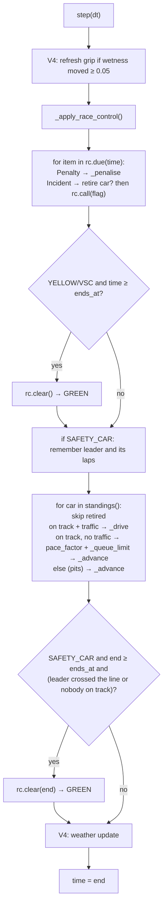

# V5: Code flow

This document traces two incidents from the README race (12 laps of Monza, 6 cars, traffic on):

1. a **retirement with a local yellow**;
2. a **Safety Car**, followed from the scripted trigger through the state change, the cars' behaviour, the log and the restart.

The movement code (`_advance`), traffic (V3), stops (V2) and weather (V4) are unchanged and are described in the earlier CODE_FLOW files.

## 1. Setup

```python
control = RaceControl(
    incidents=[Incident(300, Flag.YELLOW, 40, retire=3, reason="Ferrari #3 stops"),
               Incident(500, Flag.SAFETY_CAR, 120, segment=0, reason="debris on the main straight")],
    penalties=[Penalty(150, 2, "time", 5, reason="track limits"),
               Penalty(200, 5, "drive-through", reason="unsafe release")],
)
race = Race(Monza(), 12, grid, race_control=control)
```

1. `Incident.__post_init__` and `Penalty.__post_init__` validate each item (IMPLEMENTATION.md §6).
2. `RaceControl.__init__` merges incidents and penalties into `script`, sorted by time (incidents first at equal times). It starts in GREEN with an empty log.
3. `Race.__init__`:
   - rejects a used `RaceControl`, unknown car numbers and segments outside the track;
   - stores `race_control`;
   - resets `retired_at`, `penalty_time` and `drive_throughs` on every car.

## 2. One step with race control



### 2.1 Inside `_drive` (traffic on), additions in V5

```
factor = time_factor(rules, driver, segment, interval, car.drs and _drs_allowed())
factor = rc.pace_factor(factor, in_zone, leads = ahead is None)      ← flag pace
allowed = _overtaking_allowed(car)                                   ← GREEN, or YELLOW outside the zone
if car.attack and not allowed: log "aborted", drop the attack
limit = _queue_limit(car, ahead)                                     ← SC: ahead − 10 m
if closing on the car ahead:
    not allowed → limit = min(limit, ahead − min_gap)                ← stay behind, no event
    allowed     → V3 attempt logic (pass, or held up with an event)
_advance(car, end, factor, limit)
DRS detection at the line also requires _drs_allowed()
```

### 2.2 Inside `_complete_lap`, additions in V5

```
finishing lap → finish_time = clock → _finish_penalties(car, clock):
                  pending drive-throughs → +20 s each ("penalty converted")
                  two-compound rule → +30 s ("penalty")
otherwise     → V2/V4 strategy stop (if any) → _pit
                then, if drive_throughs and the flag is GREEN or YELLOW:
                  pit_exit = max(pit_exit, clock) + 20 s ("penalty served")
```

## 3. Trace 1: penalties, then a retirement with a yellow

| Race time | What happens | Code | Event logged |
|---|---|---|---|
| 150.1 s | `Penalty(150, 2, "time", 5)` comes due | `_penalise`: #2 `penalty_time` 0 → 5 | `penalty`, GREEN, (2,), "+5 s for #2: track limits" |
| 200.1 s | `Penalty(200, 5, "drive-through")` comes due | `_penalise`: #5 `drive_throughs` 0 → 1 | `penalty`, GREEN, (5,) |
| 286.1 s | #5 completes lap 3 under GREEN | `_complete_lap`: `pit_exit` = 286.1 + 20 = 306.1 s; `drive_throughs` → 0 | `penalty served`, (5,) |
| 300.1 s | `Incident(300, YELLOW, 40, retire=3)` comes due | #3 `retired_at` = 300.1. Its segment index is 0 (main straight), so `rc.call(YELLOW, 300.1, 40, zone=0)` gives GREEN → YELLOW with `ends_at` = 340.1 s. | `retirement` (3,), then `flag` "GREEN -> YELLOW" with the running cars (1, 2, 4, 5, 6) |
| 300.1–340.1 s | Cars inside segment 0 | `pace_factor` × 1.10 and `overtaking_allowed(in_zone=True)` is False. Elsewhere, normal racing. DRS is off everywhere. | — |
| 340.1 s | `time ≥ ends_at` at the start of the step | `_apply_race_control` → `rc.clear` | `flag` "YELLOW -> GREEN: YELLOW period over" |

From 300.1 s, #3 never moves again. It is excluded from `car_ahead`, and `standings()` puts it last.

## 4. Trace 2: Safety Car from trigger to restart

### 4.1 Trigger and state change (step 500.0 → 500.1)

At the start of the step, `rc.due(500.0)` returns `Incident(500, SAFETY_CAR, 120, segment=0)`:

- there is no car to retire;
- `rc.call(SAFETY_CAR, 500.0, 120, zone=0, cars=(1, 2, 4, 5, 6), reason)`:
  - SAFETY_CAR is more severe than GREEN, and `check_transition(GREEN, SAFETY_CAR)` passes;
  - `flag = SAFETY_CAR`, `ends_at = 620.0`, `zone = None` (zones are for yellows only);
  - logged: `flag`, SAFETY_CAR, cars (1, 2, 4, 5, 6), "GREEN -> SAFETY_CAR: debris on the main straight".
- `safety_car = True`. The leader at the start of the step is #1, on 5 laps.

### 4.2 Car behaviour under the Safety Car

In `_drive`, for each car in race order:

| Car | Car ahead | `pace_factor` | `_queue_limit` | Overtaking |
|---|---|---|---|---|
| #1 | none (leads) | 1.60 | none | not allowed |
| #2 | #1 | 1.30 (catch-up) | #1.distance − 10 m | not allowed |
| #6 | #2 | 1.30 | #2.distance − 10 m | not allowed |
| #4 | #6 | 1.30 | #6.distance − 10 m | not allowed |
| #5 | #4 | 1.30 | #4.distance − 10 m | not allowed |

The catch-up cars cover track faster than the queue leader until they reach their limit. Then `_advance` stops them at the limit for the rest of the step, so they hold a 10 m gap.

On-track gaps, front to back:

| Race time | Order | Gaps (m) |
|---|---|---|
| 520 s | 1, 2, 6, 4, 5 | 14.4, 32.1, 306.2, 938.8 |
| 540 s | 1, 2, 6, 4, 5 | 10.0, 10.0, 173.2, 614.3 |
| 580 s | 1, 2, 6, 4, 5 | 10.0, 10.0, 10.0, 674.9 |

#5's gap grows between 540 and 580 s while it closes on the queue. It is on a different part of the lap, and the gap is measured along the track.

### 4.3 Pit stops under the Safety Car

The one-stoppers' planned stops after lap 6 fall inside the SC:

| Car | Stop time | `pit_exit` |
|---|---|---|
| #1 | 607.7 s | 629.7 s |
| #2 | 608.0 s | 630.0 s |
| #5 | 618.7 s | 640.7 s |

While in the pits, a car is off track: `_on_track` is False, so `car_ahead` skips it. The no-stoppers #6 and #4 therefore become the front of the queue: at 620 s the on-track order is [6, 4]. The stoppers rejoin at the back and catch up at the 1.30 pace: by 740 s the gaps are 10, 10, 10 m.

At each step the "leader" used for the SC end is recomputed: the first car in `standings()` that is on track. While #1 and #2 are in the pits, that is #6.

### 4.4 Ending the Safety Car (step 760.5 → 760.6)

- `ends_at` = 620.0 has passed, but the SC stays out until the leader crosses the line.
- At the start of the step the leader is #6, on 6 laps. During the step #6 crosses the line (laps 6 → 7, now 1 m into lap 7).
- After the cars have moved: `end` (760.6) ≥ 620.0 and #6's laps increased, so `rc.clear(760.6, running, "safety car in; restart at the line")`.
- Logged: `flag`, GREEN, "SAFETY_CAR -> GREEN: safety car in; restart at the line".

### 4.5 Racing resumes

From the next step `pace_factor` returns the normal V3 factor and `overtaking_allowed` is True:

| Time | Overtake event |
|---|---|
| 767.2 s | #4 passed #6 |
| 769.1 s | #1 passed #6 (fresher hard tyres) |
| 774.2 s | #2 passed #6 |

The restart happened with the queue 10 m apart. That is why these passes come within 14 s of the restart: the SC wiped out the time gaps.

### 4.6 Classification

At their finishes:

- `_finish_penalties` adds +30 s to #6 and #4, who used only mediums: logged `penalty` at 1238.1 s and 1240.8 s.
- `standings()` ranks the finishers by `total_time`. #2 (raw 1237.489 s + 5 s = 1242.489 s) falls behind #5 (1238.207 s).
- #3 (retired) is last.

## 5. Debugging guide

| Question | How to check |
|---|---|
| What is race control doing now? | `race.race_control.flag`, `.zone`, `.ends_at` |
| Why is a car slow? | `rc.pace_factor(normal_factor, race._in_zone(car), race.car_ahead(car) is None)` |
| Why can't it pass? | `race._overtaking_allowed(car)` and `race._queue_limit(car, race.car_ahead(car))` |
| Why no DRS? | `race._drs_allowed()`: the flag must be GREEN and wetness ≤ 0.3 |
| What is still to come? | `rc.script[rc._next:]` |
| Full history | `for e in rc.events: print(e.time, e.kind, e.flag.name, e.cars, e.detail)` |
| A car's penalties | `car.penalty_time`, `car.drive_throughs`, `race.total_time(car)` |
| Is a transition legal? | `check_transition(old, new)` raises `ValueError` if not |
| Why didn't the SC end at `ends_at`? | It waits for the leader to cross the line. Check the leader's `laps` step by step. |
| Same as V4? | `race_control=None`, or a quiet `RaceControl` (see the regression test) |
