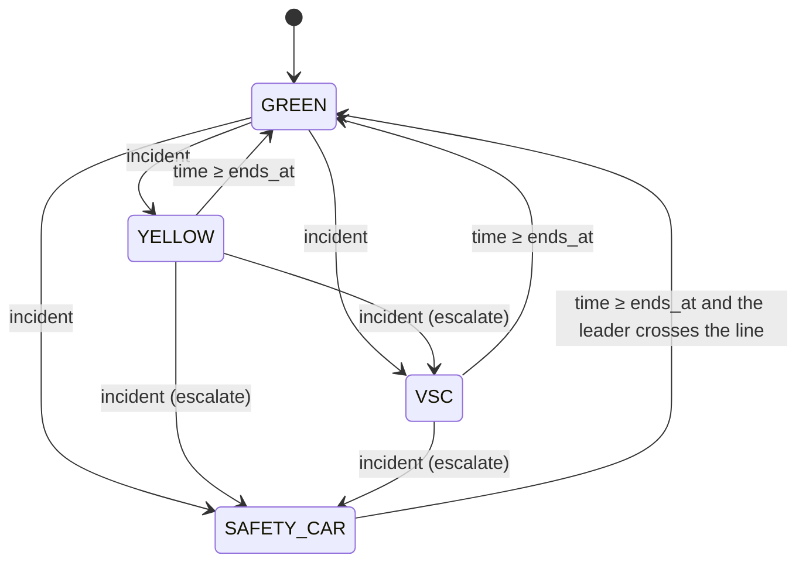

# V5: Race control, incidents and penalties (implementation)

## 1. Objective and scope

Up to V4 a race ran uninterrupted from start to finish: every car finished, and its race time was simply when it crossed the line. V5 adds a **race-control** layer:

- **flags:** a local yellow, a Virtual Safety Car (VSC) and a Safety Car (SC), each with defined effects on the cars and a defined end;
- **incidents** that call those flags and/or **retire** a car;
- a small set of **penalties:** time penalties, drive-throughs and one rule-based penalty (the two-dry-compound rule);
- a **race-control event log;**
- a classification that ranks finishers by **race time including penalties**, then running cars, then retired cars.

V5 is **not** the FIA Sporting Regulations. It is a small, coherent subset with model choices, listed in §13.

Not implemented: red flags, investigations and stewarding procedures, blue flags and unlapping, the chequered-flag rule for lapped cars (still deferred), a safety-car vehicle with its own position, restart procedures, random incidents.

## 2. What was added or changed

| Item | Where | New / changed |
|---|---|---|
| `Flag`, `TRANSITIONS`, `check_transition` | `race_control.py` | **new**: the state model |
| `RaceControlRules` | `race_control.py` | new: effect and penalty parameters |
| `Incident`, `Penalty` | `race_control.py` | new: scripted triggers (validated) |
| `ControlEvent` | `race_control.py` | new: event record |
| `RaceControl` (`due`, `log`, `call`, `clear`, `pace_factor`, `overtaking_allowed`) | `race_control.py` | new: state machine and script |
| `RaceCar.retired_at`, `.penalty_time`, `.drive_throughs` | `race.py` | new fields |
| `Race(race_control=None)`, `total_time`, `_apply_race_control`, `_penalise`, `_running`, `_in_zone`, `_queue_limit`, `_overtaking_allowed`, `_drs_allowed`, `_finish_penalties`, `_segment_index` | `race.py` | new |
| `Race.step`, `_drive`, `_complete_lap`, `_on_track`, `finished`, `standings`, `car_ahead` docstring | `race.py` | changed |

## 3. Who owns what

```
race_control.py   flags, legal transitions, the script, pace and overtaking rules per flag, the event log
                  (knows nothing about cars, physics, tyres or weather)
race.py           applies them: when the script is read, which car retires or is penalised, how cars
                  move under each flag, serving and converting penalties, classification
traffic.py        unchanged; race.py simply refuses attacks when race control forbids overtaking
strategy.py, tyres.py, weather.py, physics.py    unchanged
```

## 4. State

### 4.1 Race-control state (`RaceControl`)

| Field | Meaning |
|---|---|
| `flag` | `Flag.GREEN`, `YELLOW`, `VSC` or `SAFETY_CAR` (an `IntEnum`, in rising order of severity) |
| `zone` | Track-segment index of the yellow zone. `None` unless the flag is YELLOW. |
| `ends_at` | s. YELLOW and VSC end at this time. For SAFETY_CAR it is the **earliest** end. |
| `events` | `ControlEvent` log |
| `script` | incidents and penalties sorted by time (incidents first at equal times) |
| `_next` | how much of the script has been handed out |

### 4.2 New per-car state (`RaceCar`)

| Field | Unit | Meaning |
|---|---|---|
| `retired_at` | s or `None` | Race time the car stopped for good |
| `penalty_time` | s | Time penalties, added to `finish_time` |
| `drive_throughs` | count | Drive-through penalties not yet served |

## 5. Transition rules



| From | Allowed to | Not allowed |
|---|---|---|
| GREEN | YELLOW, VSC, SAFETY_CAR | GREEN |
| YELLOW | GREEN, VSC, SAFETY_CAR | YELLOW |
| VSC | GREEN, SAFETY_CAR | YELLOW, VSC |
| SAFETY_CAR | GREEN | YELLOW, VSC, SAFETY_CAR |

- `check_transition(old, new)` raises `ValueError` for anything outside this table. A test checks all 16 pairs.
- **Escalation only.** `RaceControl.call(flag, ...)` moves to `flag` only if it is **more severe** than the current flag.
- **Extension.** If an incident asks for the same or a milder flag, the current period is extended to cover it: `ends_at = max(ends_at, time + duration)`. The yellow zone stays where the first incident put it. This is logged as `"extended"`.
- **Leaving a flag.** Nothing de-escalates except to GREEN, and only by its own end condition.

**Why no state can get stuck:**

1. Every flag gets a finite duration greater than 0, checked in `Incident`.
2. YELLOW and VSC end as soon as `time ≥ ends_at`.
3. SAFETY_CAR needs `time ≥ ends_at` **and** the leader (the first car in the standings that is on track) to cross the line.
   - Under the SC the leader laps at 1.6 × its flying lap, so this happens within one slow lap.
   - If no car is on track at that step (all finished, retired or in the pits), the SC ends as soon as `time ≥ ends_at`.
4. A race always ends: `finished` is true once every car has either finished or retired.

## 6. Triggers

All triggers are either scripted or rule-based. There is no randomness.

| Trigger | Kind | Effect |
|---|---|---|
| `Incident(time, flag, duration, retire, segment, reason)` | scripted | Optionally retires one car, then calls a flag (if given) for `duration` s |
| `Penalty(time, car, kind, seconds, reason)` | scripted (stewards' decision) | `"time"`: +`seconds` to the race time. `"drive-through"`: one pit-lane pass to serve. |
| A retirement with a YELLOW and no `segment` | rule | The yellow zone is the segment where the car stopped |
| A finish with fewer than two dry compounds and no wet tyres | rule | +`two_compound_penalty` (30 s) |
| A drive-through still pending at the finish | rule | Converted to +`drive_through_loss` (20 s) |
| A flag other than GREEN, or wetness above `drs_max_wetness` (0.3) | rule | DRS is unavailable |

Validation (`ValueError`):

- **Incident:** time below 0; calling GREEN; a flag without a finite duration greater than 0; neither a flag nor a retirement; a YELLOW with neither a segment nor a retiring car.
- **Penalty:** time below 0; a kind other than `"time"` or `"drive-through"`; a time penalty with `seconds ≤ 0`.
- **At `Race(...)`:** an unknown car number; a segment outside the track; a `RaceControl` that has already been used.

At run time:

- retiring a car that has already finished or retired is logged as `"ignored"`;
- a penalty for a retired car is logged as `"ignored"`.

## 7. How cars respond

| Flag | Pace (time factor) | Overtaking | DRS | Extra rule |
|---|---|---|---|---|
| GREEN | normal (V3: driver × dirty air × DRS) | allowed (V3 rules) | allowed if wetness ≤ 0.3 | — |
| YELLOW | ×(1 + 0.10) **inside the yellow segment**, normal elsewhere | not inside the yellow segment | off everywhere | — |
| VSC | **1.40** for every car on track (40 % slower than its own flying lap) | none | off | — |
| SAFETY_CAR | **1.60** for the car leading the queue; **1.30** for the others | none | off | A car may not get closer than `sc_gap = 10 m` to the car ahead |

How these are applied:

- The pace factor replaces or multiplies the V3 factor in `Race._drive`, or the driver factor when `traffic=None`. It goes through the same `_advance(factor, limit)` as before.
- **Bunching under the SC.** The cars behind run at 1.30 and the queue leader at 1.60, so the cars behind close up until the queue limit holds them 10 m behind the car ahead. The gaps shrink to 10 m. In the README race, the first four cars closed from gaps of up to 306 m to 10 m within about 80 s. The fifth car, 939 m back, was still closing when the leaders pitted.
- **No overtaking.**
  - With traffic on, a car closing on the car ahead is held at `min_gap` with no pass attempt and no "held up" event. An attack in progress is abandoned (`"aborted"`) the moment overtaking stops being allowed.
  - Without traffic, the SC queue limit still prevents passing. Under VSC or yellow, V2-style "ghost" cars can still pass through each other.
- **Pit stops** are open under every flag and cost the usual `pit_loss`. Rivals are slower under VSC and SC, so a stop costs less relative to them. In a test, the relative loss is 21.8 s under green and 15.5 s under VSC.
- **Drive-throughs** are served at the next line crossing under GREEN or YELLOW, never under VSC or SC. Serving one extends `pit_exit` by `drive_through_loss`, after any pit stop at the same crossing.

## 8. Retirements

When an incident retires a car:

- `retired_at` is set to the race time;
- its attack and held-up state are cleared;
- it stops where it is and never moves again;
- `_on_track` is false for it, so it is nobody's "car ahead": it does not block, and it is not a DRS target;
- it no longer counts for `finished`, and it is ranked below all running and finished cars;
- `laps_completed` still reports its laps.

A retirement can also bring out a flag in the same incident, for example a yellow at the spot where the car stopped.

## 9. Penalties and classification

```
total_time(car) = finish_time + penalty_time            (None until the car finishes)
```

| Penalty | Applied | Effect |
|---|---|---|
| Time (`seconds`) | when issued | `penalty_time += seconds`. It only matters at the classification; a car is not slowed on track. |
| Drive-through | at the next line crossing under GREEN or YELLOW | the car spends `drive_through_loss` (20 s) in the pit lane. If it finishes first, the penalty becomes +20 s of `penalty_time` (logged `"penalty converted"`). |
| Two dry compounds | at the finish | A finisher whose start compound plus fitted compounds include no INTERMEDIATE or WET and fewer than two different compounds gets +`two_compound_penalty` (30 s). A fresh set of the same compound does not count as a second compound. Set it to 0 to switch the rule off. |

The real-world sanction for breaking the two-compound rule is stricter than 30 s. The 30 s is a model choice.

**Standings and classification** (`Race.standings`):

1. finished cars by `total_time` (penalties included);
2. running cars by distance;
3. retired cars by distance.

Ties keep grid order (stable sort).

A penalty can therefore change the result after the car crosses the line. In the README race, #2 crosses 0.7 s ahead of #5 but is classified behind it after a 5 s penalty.

## 10. Event types and ordering

`ControlEvent(time, kind, flag, cars, detail)`. `flag` is the race-control state **after** the event. `cars` lists the cars affected.

| `kind` | Logged when | `cars` |
|---|---|---|
| `"flag"` | the flag changes (detail `"OLD -> NEW: reason"`) | every running car |
| `"extended"` | an incident asks for the current or a milder flag | every running car |
| `"retirement"` | a car stops for good | that car |
| `"penalty"` | a time penalty or drive-through is issued, or the two-compound rule fires at the finish | that car |
| `"penalty served"` | a drive-through is served | that car |
| `"penalty converted"` | a drive-through is still pending at the finish | that car |
| `"ignored"` | a retirement or penalty for a car that has already stopped | that car |

**Order within one `Race.step(dt)`:**

1. V4 grip refresh, if wetness has moved by 0.05 or more.
2. `_apply_race_control()`:
   - for every script item with `time ≤ race.time`, in order, apply it. An incident is applied as its retirement first, then its flag; incidents come before penalties at equal times.
   - then, if the flag is YELLOW or VSC and `race.time ≥ ends_at`, clear it to GREEN.
3. If the SC is out, note the leader and its laps.
4. Move the cars in race order (V3). Line crossings inside `_advance` may serve drive-throughs or apply finish penalties. Those events carry the exact crossing time.
5. If the SC is out, `end ≥ ends_at`, and the leader crossed the line this step (or nobody is on track), clear the SC at `end`.
6. Advance the weather (V4).

The log is therefore in non-decreasing time order, which a test checks. Scripted items take effect at the first step whose start time has reached them, so they are at most one `dt` late.

## 11. Integration with earlier models

| Model | Interaction |
|---|---|
| Traffic (V3) | Overtaking refused or abandoned under flags; the SC queue limit combined with `min_gap` (the stricter wins); DRS off unless green and dry enough |
| Pit stops (V2) | Open under all flags, so relatively cheaper under VSC and SC; drive-throughs use the same `pit_exit` mechanism |
| Tyres (V2, V4) | Two-compound rule; wet tyres exempt |
| Fuel (V2) | Unchanged. A slow lap burns the same 1.9 kg (a limitation). |
| Weather (V4) | DRS disabled above 0.3 wetness. Rain does not trigger flags. |
| No race control | `race_control=None` (the default) is V4 exactly (regression test against recorded V4 results). A `RaceControl` with nothing scripted, the two-compound rule off and `drs_max_wetness=1.0` gives identical results too (tested). |

## 12. Worked example: the README race

The race is 12 laps of Monza, 6 cars, traffic on:

- one-stoppers (medium → hard after lap 6): #1, #2, #3, #5;
- no-stoppers on mediums: #4, #6.

Events and effects:

1. **150 s.** #2 gets +5 s (track limits). **200 s.** #5 gets a drive-through, which it serves at its next crossing, 286.1 s.
2. **300.1 s.** #3 retires on the main straight (segment 0). A YELLOW comes out in segment 0 until 340.1 s: cars there run 10 % slower and may not pass there.
3. **500.0 s.** SAFETY_CAR, with a minimum of 120 s (so `ends_at` = 620 s).
   - The queue forms: the first four cars close to 10 m apart within about 80 s, while #5, 939 m back, keeps closing.
   - #1, #2 and #5 make their planned stops under the SC (607.7–618.7 s). They rejoin behind the no-stoppers #6 and #4, who now lead.
4. **760.6 s.** The leader #6 crosses the line after `ends_at`, so the SC goes back to GREEN.
   - Racing resumes: #4 passes #6 at 767.2 s, then #1 and #2 on fresher hard tyres pass #6 at 769.1 s and 774.2 s.
5. **Finish.** The no-stoppers #6 and #4 each get +30 s (one dry compound only). #3 is classified last, DNF.

```
1. #1 McLaren  1 stop  1233.857 s
2. #5 McLaren  1 stop  1238.207 s
3. #2 Red Bull 1 stop  1242.489 s  (incl. +5 s penalty)
4. #6 Red Bull no stop 1268.120 s  (incl. +30 s penalty)
5. #4 Mercedes no stop 1270.767 s  (incl. +30 s penalty)
6. #3 Ferrari  1 stop  DNF
```

## 13. Assumptions and limitations

1. **No safety-car vehicle.** The car leading the queue simply runs at 1.6 × its flying lap.
2. **No restart procedure.** At GREEN, overtaking and DRS detection resume at once. Real F1 waits for the line and re-enables DRS only later.
3. **One yellow zone at a time**, one track segment long. A later yellow extends the time but keeps the first zone.
4. **VSC is a uniform 40 % slow-down** of each car's own lap, not a delta-time target.
5. **Incidents and retirements are scripted.** There are no failure or crash models. A retired car leaves no debris and does not block.
6. **Time penalties are added at the end.** They are not served at a pit stop. Drive-throughs cannot be served under VSC or SC.
7. **The two-compound rule is applied per car**, and is exempt if that car used wet tyres. The real rule depends on race conditions and its sanction is stricter.
8. **Lapped cars:** no blue flags, no unlapping under the SC, no chequered-flag rule. Every running car still completes the full distance.
9. **Fuel and tyre wear per lap are unchanged under VSC and SC.**
10. **Script timing is quantised to `dt`.** Event times can be up to one step late.
11. **Without traffic rules,** only the SC queue stops cars passing. VSC and yellow still slow them.
12. **All values are placeholders** (V6 calibration): 10 % yellow, 1.4 VSC, 1.6 and 1.3 SC, 10 m queue, 20 s drive-through, 30 s two-compound penalty, 0.3 DRS wetness limit.
