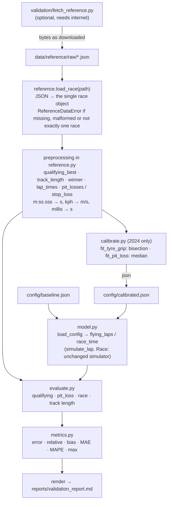

# V6: Code flow

This document traces the validation workflow from the raw reference files to the generated report. The simulator itself (V0–V5) is called but not changed.

## 1. Overview



## 2. Loading and checking

`reference.load_race(path)`:

1. reads the file. A missing file raises `ReferenceDataError("missing reference file …")`;
2. `json.loads` reads `["MRData"]["RaceTable"]["Races"]`. Bad JSON or a missing key raises `ReferenceDataError("malformed …")`;
3. requires **exactly one** race;
4. returns that race's dictionary.

Every later lookup goes through `_field(record, *keys)`. A missing field raises `ReferenceDataError` naming the path, so no default value is ever substituted.

## 3. Preprocessing, traced

### 3.1 Qualifying: `qualifying_best(2024)`

Raw entry in `2024_qualifying.json`:

```
{"position": "1", "Driver": {"code": "NOR"}, "Constructor": {"name": "McLaren"},
 "Q1": "1:19.911", "Q2": "1:19.727", "Q3": "1:19.327"}
```

1. The team "McLaren" is one of `TEAMS`, so the entry is kept. Teams the model doesn't have are skipped.
2. For each of Q1, Q2 and Q3 that exists, `lap_time_seconds("1:19.327")`:
   - the regex gives `minutes = "1"` and `seconds = "19.327"`;
   - seconds below 60 are accepted;
   - result: 1 × 60 + 19.327 = **79.327 s**.
3. Keep the fastest per team across both drivers, so McLaren is **(79.327, "NOR")**.
4. If any of the four teams has no time, raise `ReferenceDataError`.

### 3.2 Track length: `track_length(2024)`

For each result with `FastestLap.AverageSpeed` (kph) and `FastestLap.Time`, for example NOR at 256.100 kph and 1:21.432:

```
256.100 / 3.6 = 71.139 m/s;   71.139 × 81.432 = 5 792.98 m
```

The result is the median over all such drivers, **5 793.0 m**. It needs at least 3 drivers. 2025 publishes no average speeds, so `track_length(2025)` raises an error rather than guessing.

### 3.3 Pit loss: `pit_losses(2024)` → `stop_loss(laps, 15, [15])` for Leclerc

1. The drivers are those whose constructor is one of the modelled teams. The stops are those drivers' entries in `2024_pitstops.json`. Leclerc stopped on lap 15.
2. `lap_times(2024, "leclerc")` gives {lap: s} for all 53 laps. Each timing must belong to that driver.
3. The disturbed laps are {1, 15, 16}: lap 1, plus the in-lap and out-lap of every stop.
4. The window runs from laps 10 to 21. Leaving out the disturbed laps and any lap above 107 % of the race median (83.731 s) gives 10 clean laps: 84.432, 84.846, 84.916, 85.529, 85.606, 84.270, 83.875, 84.203, 83.826, 83.880. Their median is **84.351 s**.
5. The in-lap (15) is 90.192 s and the out-lap (16) is 104.888 s.

```
loss = 90.192 + 104.888 − 2 × 84.351 = 26.378 s
```

6. A window with fewer than 3 clean laps returns `None`, and the stop is skipped. A season with fewer than 3 measured stops raises an error.

Result for 2024: 14 stops, median **25.62 s**, range 24.42–34.85 s.

### 3.4 Winner: `winner(2024)`

From `results`, position "1" is LEC (Ferrari). Its time is `millis` 4480727 ÷ 1000 = **4 480.727 s**, over 53 laps. From `pitstops`, its stop laps are [15].

## 4. Calibration (`python3 -m validation.calibrate`)

1. `calibrate()` reads `qualifying_best(2024)` and `pit_losses(2024)` only.
2. `fit_tyre_grip(best)`:
   - `bias(g)` = the mean of (`flying_laps({"tyre_grip": g})[team]` − real best) over the 4 teams;
   - check `bias(1.0) > 0` (too slow) and `bias(5.0) < 0` (too fast), otherwise raise `ValueError`;
   - halve [low, high] until it is narrower than 10⁻⁴, keeping the half where the sign changes;
   - round to 4 decimals: **2.9358**.
3. `fit_pit_loss(losses)` is the median of the 14 values: **25.62**.
4. The JSON written includes the method, the training data and the baseline values. It is sorted and has no timestamps, so a re-run gives identical bytes.

## 5. Simulation runs (`validation/model.py`)

- `load_config(name)` reads the JSON. It requires `tyre_grip` > 0 and `pit_loss` ≥ 0, both numbers.
- `flying_laps(config, teams)` returns `simulate_lap(CARS[team], Monza(), config["tyre_grip"])[0]` for each team. It uses V2's `tyre_grip` parameter; no global is changed.
- `race_time(config, team, laps, stop_laps)`:
  - `scale = tyre_grip / 1.8`; every compound's grip is multiplied by it, in a **copy** of the table;
  - the strategy is mediums plus `PitStop(lap, HARD)` for each real stop lap (compounds assumed);
  - `Race(Monza(), laps, [one car], pit_loss=…, compounds=copy, traffic=None).run(0.5)`;
  - returns the car's `finish_time`.

## 6. Metrics and report (`python3 -m validation.evaluate`)

`evaluate()` builds, for `baseline` and `calibrated` × {2024 training, 2025 held out}:

- **qualifying:** rows of (team, driver, reference, model), plus MAE, bias, MAPE, max |error| and the fastest team in each;
- **pit_loss:** n, median, range, model value, MAE against the individual stops;
- **race:** the winner and the model's race time;
- **track length:** model against reference, independent of the configuration.

`render(result)` formats everything as Markdown with fixed precision. `main()` writes `validation/reports/validation_report.md` and prints it.

Example row (baseline, 2024): McLaren, reference 79.327 s (NOR), model 93.998 s, error +14.671 s, relative +18.49 %.

## 7. Tests that guard the workflow

| Test | What breaks it |
|---|---|
| `test_lap_time_and_unit_conversion` | a change to time or speed parsing |
| `test_real_reference_files_load_and_check_out` | a raw file changed or a loader bug |
| `test_missing_malformed_and_insufficient_data_is_rejected` | a loader guessing instead of raising |
| `test_pit_loss_measurement_on_a_known_example` | a change to the pit-loss rule |
| `test_metrics_on_known_examples` | metric formulas |
| `test_calibration_is_reproducible_and_matches_the_committed_config` | non-determinism, or a stale `calibrated.json` |
| `test_calibration_refuses_an_impossible_fit` | a silent fit outside the range |
| `test_baseline_and_calibrated_configs_are_separate_and_leave_the_simulator_alone` | the baseline drifting from the code, or calibration leaking into globals |
| `test_committed_report_is_up_to_date` | a stale report |

## 8. Debugging guide

| Question | How to check |
|---|---|
| What does the loader see? | `from validation import reference as r; r.qualifying_best(2024)`, `r.pit_losses(2025)`, `r.winner(2025)` |
| Why was a stop skipped? | `r.stop_loss(r.lap_times(season, driver), lap, stop_laps)` returns `None` when there are fewer than 3 clean laps |
| A loader error | The `ReferenceDataError` message names the file and the missing field |
| What does the model give for a config? | `from validation.model import load_config, flying_laps; flying_laps(load_config("calibrated"), ["McLaren"])` |
| The report test fails | Re-run `python3 -m validation.calibrate` and then `python3 -m validation.evaluate`, and check the diff |
| The data changed upstream | Re-fetch only on purpose. The committed raw files are the frozen reference. |
