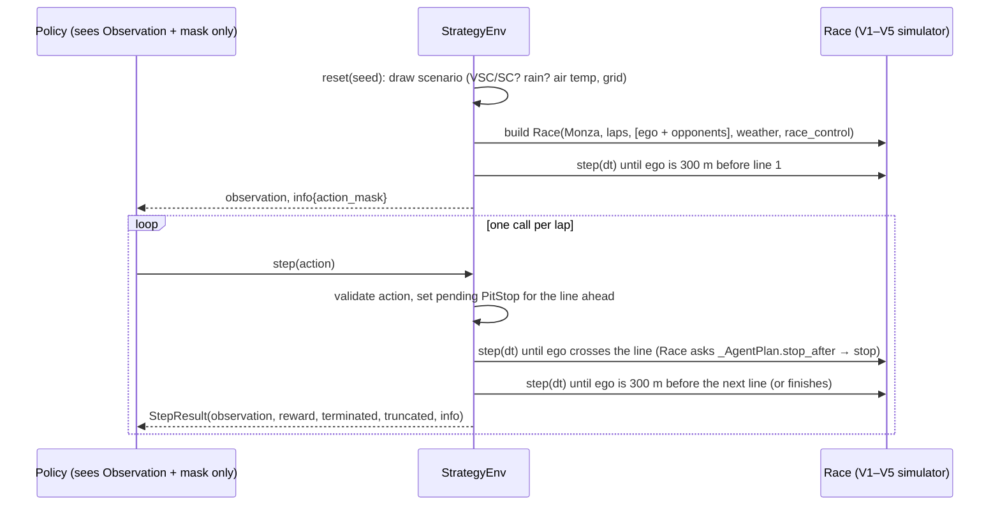

# V7: Code flow

This document traces one complete episode, from `reset()` through each observation, action and reward to termination, and then how the evaluation tooling uses episodes. The simulator internals are described in the V1–V6 CODE_FLOW files.

## 1. Overview



## 2. `StrategyEnv(...)` (construction)

1. Validate the arguments: `laps ≥ 2`, a known `team`, `pit_loss ≥ 0`, `dt > 0`, chances in [0, 1], 0–3 opponents, `max_steps`.
2. `reference_lap = simulate_lap(CARS[team], Monza())[0]`. That is 93.998 s for the McLaren, and it is the reward scale.
3. `self._rng = random.Random(seed)`.

## 3. `reset(seed=16)` (traced with `laps=10`, `RuleBased()`)

1. `seed` is given, so `self._rng = random.Random(16)`.
2. `_draw_scenario()`, in this order of random draws:
   - air temperature uniform 18–32 °C: **23.1 °C**;
   - chance of a neutralisation at 0.5: yes, so the flag is chosen from VSC or SC: **SAFETY_CAR**, at **304.6 s** (uniform over 15–85 % of `laps × reference_lap × 1.05`), for **60.5 s**;
   - chance of rain at 0.25: no.
3. `_AgentPlan(MEDIUM, fuel = 10 × 1.9 = 19 kg)`: the duck-typed strategy with `pending = None`.
4. Grid: `[ego]` plus any opponents, shuffled by the generator. Here the car is alone.
5. `Race(Monza(), 10, grid, pit_loss=22, traffic=None, weather=None, race_control=RaceControl([Incident(304.6, SAFETY_CAR, 60.5)], rules))`.
6. `_run_to_decision()`: `race.step(0.5)` until `distance ≥ 1 × 5900 − 300` m. The race clock is now **89.5 s**.
7. `_observe()` returns `Observation`:

   ```
   progress 0.0 | medium 1 | tyre_wear 0.0 | fuel 19/110 = 0.173 | stops 0 | two_compounds 0
   green 1 | wetness 0 | rain 0 | position 0 | gap_ahead 1 | gap_behind 1
   ```

   `info["action_mask"]` is all True.

## 4. The steps

`step(action)` does the following:

1. **Checks.** Validate the type and range, and that the action is not masked.
2. **Pending decision.** `lap = car.laps + 1`, the line just ahead. `pending = PitStop(lap, X)` or `None`.
3. **Run to and across the line.** `race.step(dt)` while `car.laps < lap`. Inside the race at the crossing, V2's `_complete_lap` calls `_AgentPlan.stop_after(lap, ...)`, which returns `pending`, so `_pit` runs.
4. **Run to the next call.** `_run_to_decision()`, or stop early if the car has finished.
5. **Score.**
   - `terminated` = the car has a finish time;
   - `truncated` = `max_steps` has been reached (not finished);
   - `end` = finish + penalties if terminated, otherwise `race.time`;
   - `reward = −(end − last_time) / 93.998`, then `last_time = end`.
6. **Return** `StepResult(_observe(), reward, terminated, truncated, _info())`.

The episode with seed 16. Times are the race clock at each call.

| # | Observation at the call (time, flag, compound, wear) | Policy → action | After the step: time, flag | Reward |
|---|---|---|---|---|
| 1 | 89.5 s, GREEN, medium, 0.00 | stay out | 184.0 s, GREEN | −1.9575 (covers 0 → 184 s, including the run to the first call) |
| 2 | 184.0, GREEN, medium, 0.03 | stay out | 278.5, GREEN | −1.0053 |
| 3 | 278.5, GREEN, medium, 0.06 | stay out | **413.5, SAFETY_CAR** (came out at 305.0 s) | −1.4362 (a slow lap behind the SC) |
| 4 | **413.5, SAFETY_CAR**, medium, 0.09, progress 0.3 | **pit for hard**: VSC/SC, no stops yet, 0.3 ≤ progress ≤ 0.85 | 533.0, GREEN (the SC came in as the car crossed line 4 at 421.5 s; stop of 22 s) | −1.2713 |
| 5–9 | GREEN, hard, wear 0.02 → 0.10 | stay out | each about 95 s | about −1.005 to −1.011 |
| 10 | 1007.0, GREEN, hard, the line ahead is the finish: mask (True, False, …) | stay out | finish **1011.908 s** | −0.0522 (the last 5 s) → `terminated = True` |

Checks on this episode:

- Σ reward = −10.7652, and 10.7652 × 93.998 = 1011.9 s = finish + penalties (0 here, because hards were fitted).
- `info["pit_stops"] = [(4, "hard")]`.
- Race-control log: `GREEN -> SAFETY_CAR` at 305.0 s, `SAFETY_CAR -> GREEN` at 421.5 s.

In the first version, where the call came just after each crossing, the same seed never showed the Safety Car to the policy. The car stayed out and took the 30 s two-compound penalty, finishing in 1018.8 s.

After termination, `step()` raises `RuntimeError` until the next `reset()`.

## 5. What `_observe()` reads (the adapter boundary)

| Observation field | Public simulator source |
|---|---|
| progress | `car.laps / laps` |
| compound one-hot, tyre_wear | `car.tyres.compound`, `car.tyres.wear(race.compounds)` |
| fuel | `car.fuel / FUEL_CAPACITY` |
| stops, two_compounds | `race.pit_events` (this car), start compound |
| flag one-hot | `race.race_control.flag` |
| wetness, rain | `race.weather.conditions` (0 if no weather) |
| position | `race.standings().index(car)` |
| gap_ahead, gap_behind | `race.car_ahead(...)`, `race.interval(...)` |

## 6. Evaluation (`python3 -m rl.evaluate`, `rl.experiment`)

1. `compare(policies, seeds, **env_kwargs)` builds one `StrategyEnv`. For each policy and each seed it calls `run_episode(env, make(seed), seed)`:
   - `reset(seed)`, then step until the episode is terminated or truncated, adding up the rewards;
   - it returns `{seed, reward, time = info["total_time"], stops, penalty, truncated}`;
   - every policy sees the same seeds, and therefore the same scenarios.
2. `summarise(results, baseline)` gives, per policy:
   - mean, sample standard deviation, minimum and maximum time;
   - mean stops and the number of penalised episodes;
   - the per-seed differences to the baseline, with their mean and standard deviation, and how many seeds were better or worse.
3. `table(rows)` produces Markdown.
4. `rl.experiment.main()`:
   - `cross_entropy_search(env, train_seeds=(0, 1, 2), 3 iterations, population 8, 2 elites, seed 0)`. Each candidate `RuleBased(...)` is scored as its mean reward over the 3 training episodes. The best candidate seen is kept;
   - `compare` the baselines and the tuned policy on **seeds 100–119**;
   - write `rl/reports/experiment_report.md`.

## 7. Debugging guide

| Question | How to check |
|---|---|
| What will happen this episode? | `info["scenario"]` (visible to you, not to the policy) |
| Why is an action rejected? | `info["action_mask"]`. On the last lap only "stay out" is allowed. |
| Where is the car? | `info["lap"]`, `info["race_time"]`, `info["flag"]`, `info["pit_stops"]` |
| Does the reward add up? | `-sum(rewards) * env.reference_lap == info["total_time"]` at termination |
| Same episode twice? | `reset(seed=s)`; the scenario and every step repeat |
| A policy misbehaves | Call it directly on an `Observation` with `observation._replace(field=value)` and the mask, as the tests do |
| Too slow | Use fewer `laps`, or fewer opponents. Each simulated lap costs about 35 ms per car (V2 profiles). |
