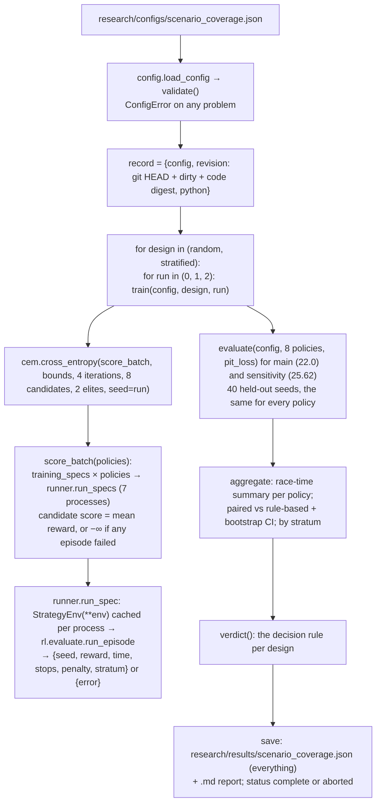

# V8: Code flow

This document traces the experiment `python3 -m research.scenario_coverage` from configuration loading through training, evaluation and aggregation to stored results. Episodes run in the unchanged V7 environment (see [../v7/CODE_FLOW.md](../v7/CODE_FLOW.md)).

## 1. Overview

## 2. Configuration loading

`load_config(path)`:

1. reads and parses the JSON. A missing file or bad JSON raises `ConfigError`;
2. `validate(config)` checks, in order:
   - the exact top-level keys;
   - non-empty text fields;
   - `laps ≥ 2`;
   - the env;
   - at least two designs, each with valid sources (chances in [0, 1], integer seeds) and **equal total training episodes**;
   - CEM: run seeds, iterations, population, elites ≤ population, and bounds for exactly the 4 thresholds, each containing its hand-set value;
   - evaluation: chances, at least 2 episodes, and **no training seed (after the per-run shift of r × 7919) inside the evaluation seed range**; the baselines must include `rule-based`;
   - sensitivity: optional `pit_loss`;
   - statistics: resamples ≥ 100, confidence in (0.5, 1);
   - `processes ≥ 1`, `max_failed_episodes ≥ 0`.

## 3. Training one design and run

`train(config, design, run)`:

1. `cross_entropy(score_batch, ...)` starts at `RuleBased()`, the hand-set thresholds, and scores it. That gives `hand_set_train_score`.
2. In each of the 4 iterations:
   - draw 8 candidates around the current mean (Gaussian, clipped to the bounds, rounded to 3 decimals);
   - score all 8 in **one batch**;
   - the 2 best valid candidates become the new mean and spread;
   - keep the best seen.
3. `score_batch(policies)`:
   - builds `training_specs` for every policy: 6 episodes each, with seeds shifted by `run × 7919`;
   - runs all of them through `run_specs` (48 episodes in parallel);
   - splits the results back per policy. Any `error` gives that candidate −∞;
   - collects failures.
4. It returns the tuned thresholds, its training score, the hand-set training score, the history, and the failed candidate and episode counts.

## 4. Evaluation, aggregation and verdict

1. `evaluate(config, policies, pit_loss)` runs 8 policies × 40 seeds = 320 specs in one parallel batch, using the evaluation distribution (VSC/SC 0.5, rain 0.25). It returns the episodes per policy, in seed order. It is called twice: once with `pit_loss` 22.0 (main) and once with 25.62 (sensitivity).
2. `aggregate`:
   - drops failed episodes and counts them;
   - for each policy, computes `summary(race times)`;
   - for each non-reference policy, computes `paired(own, rule_based, 2000, seed 0, 0.95)`: differences on the seeds both completed, the mean, std, bootstrap CI and better/worse/tie counts. It also computes the mean difference by stratum (`quiet`, `neutralised`, `wet`, from `runner.stratum(env.scenario)`).
3. `verdict` collects, per design, the 3 runs' CIs: how many lie below 0 and how many above. "Helps" means at least 2 below. It also gives the mean and std of the run means.
4. The status is `complete` unless the failed episodes exceed `max_failed_episodes`. In that case the record is still saved with status `aborted`, and `ExperimentError` is raised.

## 5. Stored results

- **`research/results/scenario_coverage.json`:**
  - `config`;
  - `revision` (`git_head`, `dirty`, `code_digest`), `python`, `wall_time_s`;
  - `training`: per design and run, the thresholds, scores, history and failures;
  - `evaluation.main` and `evaluation.sensitivity`: per-episode results, summaries and verdict;
  - `failed_episodes`, `status`.
- **`research/results/scenario_coverage.md`:** `report(record)`, regenerated from the JSON. A test checks that they match.

## 6. Traced numbers from the committed run

### 6.1 Training: `train(config, "random", 0)`

1. Training specs: 6 episodes, StrategyEnv(VSC/SC 0.5, rain 0.25), seeds 0–5 (run 0, so the shift is 0).
2. `cross_entropy(...)` scores `RuleBased()` (hand-set): mean reward **−55.6828**, about 5234 s per race.
3. Per iteration (8 candidates, so 48 episodes per batch, run on 7 processes):

| Iteration | Best so far | Elite mean |
|---|---|---|
| 1 | −55.6372 | −55.6511 |
| 2 | −55.6372 | −55.6457 |
| 3 | −55.6372 | −55.6372 |
| 4 | −55.6372 | −55.6372 |

4. The best, found in iteration 1, is (wear 0.671, neutral 0.316–0.598, final call 0.902). Its training gain is (−55.6372 + 55.6828) × 93.998 = **4.28 s per race**.

### 6.2 Evaluation: one paired comparison

- `evaluate(config, policies, 22.0)` runs 8 × 40 = 320 episodes.
- First seeds for hand-set vs tuned random run 0 (race time s, stops, stratum):

| Seed | Hand-set | Tuned random run 0 | Difference |
|---|---|---|---|
| 1000 | 5407.8, 4 stops, wet | 5407.8, 4, wet | 0.0 |
| 1001 | 5129.9, 1, neutralised | 5130.1, 1, neutralised | +0.2 |
| 1002 | 5408.9, 3, wet | 5442.8, 5, wet | **+33.9** (two extra stops in the rain) |
| 1003 | 5495.3, 4, wet | 5495.3, 4, wet | 0.0 |

- Over all 40 seeds, `paired()` gives a mean of +1.21 s, std 5.79 s, and a bootstrap CI of [−0.10, +3.45]: 8 better, 27 worse, 5 ties.
- `verdict()`: the random design has 0 of 3 runs with a CI below 0, so it does not help.

### 6.3 Storage

- `save()` writes `scenario_coverage.json` (about 146 KB) and renders `scenario_coverage.md` from the **same JSON text**.
- `revision.code_digest` was `67ad4b18…` for the first run. For the committed (second) run it is `b6ab7471…`, the digest of the final code, as checked by the test.

## 7. Debugging guide

| Question | How to check |
|---|---|
| Will my config run? | `python3 -c "from research.config import load_config; load_config('path.json')"` |
| A quick pipeline check | `python3 -m research.scenario_coverage research/configs/smoke.json` (4-lap races, about 20 s, not a result) |
| Which code produced a result? | `revision.code_digest` in the JSON, compared with `python3 -c "from research.runner import code_digest; print(code_digest())"` |
| Why did a candidate score −∞? | `training[i].errors` (first 5 messages) and `failed_episodes` |
| Per-race details | `evaluation.main.episodes[policy]`: seed, time, stops, penalty, stratum |
| Is the result order parallel-safe? | `run_specs` returns results in input order; a test compares 1 and 3 processes |
