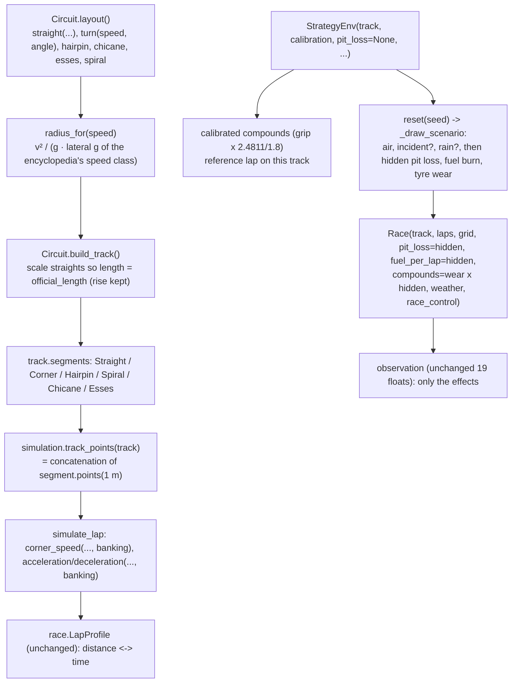

# V9: Code flow

This document traces three paths:
1. how a circuit is built from its layout;
2. how a segment becomes lap-model points;
3. how one RL episode draws and applies its hidden conditions.

The race loop itself is unchanged (see [../v5/CODE_FLOW.md](../v5/CODE_FLOW.md) and [../v7/CODE_FLOW.md](../v7/CODE_FLOW.md)).

## 1. Overview

## 2. Building a circuit: `Sepang()`

1. `Track.__init__` calls `Circuit.build_track`, which calls `Sepang.layout()`.
2. Each builder makes a segment:
   - `turn(90, 90)`: `radius_for(90)`. 90 km/h lies between the slow (87.5 km/h, 2.5 g) and medium-slow (115 km/h, 3.0 g) class midpoints, so G = 2.5 + 0.5 × 2.5/27.5 = 2.545. Then r = 25.0² / (9.81 × 2.545) = **25.0 m**, and the corner is a `Corner(length = π/2 × 25.0, radius 25.0, gradient 0)`.
   - `hairpin(70, 160)`: `Hairpin(radius_for(70), angle=160)`, whose length = radius × 160°.
   - `esses(250, 260, angle=30)`: an `Esses` of two 30° turns.
3. `build_track` sums the lengths:
   - straights (`Straight` instances) are 4,150 m as estimated;
   - corners are everything else.

   `straight_scale` = (5,543 − corners) / 4,150 = 1.12. Each straight becomes `Straight(length × 1.12, inf, gradient / 1.12)`, which keeps its rise in metres.
4. `track.length` = 5,543.0 m. `test_every_circuit_is_complete_and_drivable` checks this for every circuit, together with:
   - a net rise of zero;
   - a scale between 0.85 and 1.6;
   - the 305 km rule for race laps;
   - that a lap simulates.

## 3. From segments to lap-model points

`track_points(track)` concatenates `segment.points(STEP)`:

| Segment | `points(1.0)` |
|---|---|
| `Straight` / `Corner` | n = max(1, round(length)) copies of (length/n, radius, gradient, banking): V0's cut, plus banking |
| `Spiral(100, 200, 50)` | 100 points. Point i has curvature 1/200 + (1/50 − 1/200)(i + 0.5)/100, and radius = 1/curvature (inf when the curvature is 0) |
| `Chicane(a, b, c)` | a's points, then b's, then c's |

`simulate_lap` unpacks four values per point:
- the corner limit is `corner_speed(spec, radius, grip, banking)`;
- the forward and backward passes pass `banking` to `acceleration` and `deceleration`, and from there to `longitudinal_grip`.

`LapProfile` only uses `ds`.

**Race segments:** `Race._segment_index` still indexes `track.segments`. A whole chicane is therefore one segment for race control (yellow zones) and for traffic. `traffic.is_straight` is False for every new type, because their `radius` is the tightest part's.

## 4. One RL episode with hidden conditions

`StrategyEnv(track="Monza")` (all other options default):

1. **Construction:**
   1. `CIRCUITS["Monza"]()` builds one track instance.
   2. `fuel_per_lap` = 0.32 × 5.793 = 1.854 kg. `start_fuel` = 53 × 1.854 × 1.08 = 106.1 kg, which is ≤ 110.
   3. `load_config("calibrated")` gives grip 2.4811. Every compound's grip is multiplied by 2.4811/1.8.
   4. `base_pit_loss` = `Monza.pit_loss` = 25.62.
   5. `reference_lap` = McLaren on Monza at grip 2.4811 = 78.78 s.
2. **`reset(seed=16)` (with `laps=10`):**
   1. `_draw_scenario` makes the V7 draws in V7's order: air 23.1 °C; an incident (SAFETY_CAR at 255.3 s for 60.5 s); no rain.
   2. Then the hidden draws:
      - pit loss = 25.62 + U(−2.5, 2.5) = **26.68 s**;
      - fuel burn = 1.854 × U(0.92, 1.08) = **1.776 kg/lap**;
      - tyre wear = 1.0 × U(0.75, 1.25) = **0.861**.
   3. `Race(...)` is built with these values. Every compound's `wear_per_lap` is × 0.861.
3. **Steps:**
   - The agent sees fuel and tyre wear move a little slower than nominal, and the Safety Car when it comes. It never sees 26.68, 1.776 or 0.861.
   - `RuleBased` pits under the SC at lap 4 for hards.
   - Total time 855.95 s; return −10.865.
   - These figures are the README example.

## 5. Experiments

| Run | Steps |
|---|---|
| V8, `research.scenario_coverage` | 1. Training specs use `env = {laps, team, track, chances}`, with no `pit_loss`, so it is hidden and random. 2. The main evaluation does the same. 3. The sensitivity evaluation adds `pit_loss=22.0`. Because the pit loss is always drawn, every other hidden draw of a seed is identical between main and sensitivity. |
| V7, `rl.experiment` | Runs unchanged on the new defaults. |

## 6. Debugging guide

| Question | How to check |
|---|---|
| Which circuits exist? | `python3 -c "from tracks import CIRCUITS; print(list(CIRCUITS))"` |
| How far were a circuit's estimated straights off? | `CIRCUITS["Baku"]().straight_scale` |
| Where is a corner? | `[(type(s).__name__, round(s.length), round(s.radius)) for s in CIRCUITS["Monaco"]().segments]` |
| Speed trace | `simulate_lap(CARS["McLaren"], CIRCUITS["Spa"](), 2.4811)[1]`: m/s per metre |
| What were a race's hidden conditions? | `env.reset(seed=s)[1]["scenario"]["hidden"]` |
| Run without hidden pit loss | `StrategyEnv(pit_loss=25.62)` |
| V7 behaviour (grip 1.8, pit loss 22 s) | `StrategyEnv(calibration="baseline", pit_loss=22.0)`. Fuel and wear are still hidden and random. |
